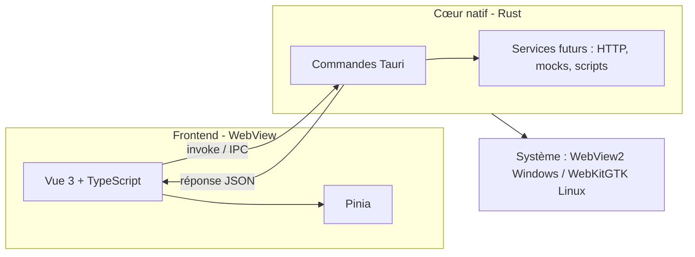

# PRD - Squelette technique Arnod (Hello World Windows)

**Version** 0.1 · **Date** 2026-11-06 · **Auteur** Julien · **Statut** Brouillon

Première installation Windows, sans droits administrateur, affichant un hello world, sur une base Tauri 2 + Vue 3 + TypeScript (cœur Rust).

## 1. Contexte et objectif

Arnod doit remplacer SoapUI et Bruno par une application de test d'API unique. Avant d'écrire la moindre fonctionnalité, il faut valider la chaîne complète : code, build, installation Windows sans élévation, lancement, et communication entre l'interface et le cœur natif.

Ce squelette sert de référence à Claude Code pour toutes les étapes suivantes.

## 2. Périmètre

**Dans le périmètre**

- Projet Tauri 2 avec frontend Vue 3 + TypeScript + Vite.
- Une commande Rust `hello` appelée depuis l'interface, qui renvoie un texte.
- Une page Vue qui affiche le résultat de cette commande.
- Installeur Windows NSIS en mode utilisateur courant.
- Build Linux (AppImage) pour vérifier la portabilité, sans l'installeur.
- Tests minimaux et CI de build (GitHub Actions, Windows et Linux).

**Hors périmètre**

- Requêtes HTTP, SOAP, mocks, scripts, assertions, CLI.
- Signature de code, mise à jour automatique (updater).
- Persistance des données.

## 3. Exigences

### 3.1 Fonctionnelles

| ID | Exigence | Priorité |
|---|---|---|
| F1 | L'application démarre et affiche « Hello World » dans la fenêtre principale. | Must |
| F2 | Le texte affiché provient d'une commande Rust appelée par l'interface, pas d'une chaîne figée côté Vue. | Must |
| F3 | Un bouton « Dire bonjour » rappelle la commande et affiche la réponse avec l'heure du cœur natif. | Should |
| F4 | L'application ferme proprement via le menu ou la croix de fenêtre. | Must |

### 3.2 Non fonctionnelles

| ID | Exigence | Cible mesurable |
|---|---|---|
| N1 | Installation sans élévation UAC. | Aucune invite de droits administrateur sur un compte standard. |
| N2 | Installation dans le profil utilisateur. | Dossier `%LOCALAPPDATA%\Programs\Arnod`. |
| N3 | Taille de l'installeur. | Inférieure à 15 Mo. |
| N4 | Temps de démarrage à froid. | Inférieur à 2 s sur un poste de référence. |
| N5 | Mémoire au repos. | Inférieure à 150 Mo. |
| N6 | Compatibilité systèmes. | Windows 10 22H2 et Windows 11, Linux x64 (Ubuntu 22.04 ou plus récent). |
| N7 | Design. | Thème clair et sombre suivant le système, police système, aucun cadre natif inutile. |

## 4. Architecture



Principes :

- Le frontend ne contient aucune logique métier. Il appelle des commandes Rust typées.
- Les commandes Rust restent dans `src-tauri/src/commands/`, une fonction par domaine.
- Les types échangés sont partagés via un fichier `src/types/ipc.ts` documenté à la main pour le hello world.

## 5. Arborescence cible

```
arnod/
├── CLAUDE.md                 # Règles pour Claude Code
├── PRD-squelette.md          # Ce document
├── package.json
├── vite.config.ts
├── src/                      # Frontend Vue
│   ├── main.ts
│   ├── App.vue
│   ├── lib/ipc.ts            # Wrapper typé autour d'invoke
│   └── types/ipc.ts
├── src-tauri/                # Cœur Rust
│   ├── Cargo.toml
│   ├── tauri.conf.json
│   ├── capabilities/default.json
│   └── src/
│       ├── main.rs
│       ├── lib.rs
│       └── commands/hello.rs
└── .github/workflows/build.yml
```

Conventions : TypeScript strict, ESLint et Prettier, `cargo fmt` et `clippy` sans avertissement, commits en Conventional Commits.

## 6. Installation sans droits administrateur

**Windows**

- Dans `tauri.conf.json`, `bundle.windows.nsis.installMode` vaut `currentUser`. Selon la documentation Tauri, l'installeur ne demande alors pas de droits administrateur et installe dans `%LOCALAPPDATA%`.
- `bundle.windows.webviewInstallMode` vaut `downloadBootstrapper` par défaut. Il télécharge le runtime WebView2 s'il manque, ce qui nécessite une connexion. Pour un poste hors ligne, passer à `embedBootstrapper` (+1,8 Mo).
- Le cas à vérifier : le runtime WebView2 n'est pas toujours présent sur un Windows 10 ancien. Son installation peut demander des droits, à tester sur une machine sans élévation.
- Sans certificat de signature, SmartScreen affiche un avertissement. Accepté pour le hello world, à traiter avant diffusion.

**Linux**

- Build AppImage, exécutable sans root. Ajouter `chmod +x` et lancer depuis le dossier utilisateur.

## 7. Critères d'acceptation

- [ ] `npm run tauri build` produit un installeur NSIS Windows et un AppImage Linux sans erreur.
- [ ] L'installeur Windows s'exécute sur un compte standard, sans invite UAC.
- [ ] Après installation, l'application est dans `%LOCALAPPDATA%\Programs\Arnod` et se lance depuis le menu Démarrer.
- [ ] La fenêtre affiche « Hello World » issu de la commande Rust (F1, F2).
- [ ] Le bouton « Dire bonjour » affiche la réponse du cœur natif (F3).
- [ ] La désinstallation via Paramètres Windows ne demande pas de droits administrateur.
- [ ] L'AppImage Linux démarre sur Ubuntu 22.04.
- [ ] La CI GitHub Actions passe sur Windows et Linux.
- [ ] Taille de l'installeur mesurée et notée dans le README (cible N3).

## 8. Plan de tâches pour Claude Code

- [ ] **T1** Créer le projet avec le template Tauri 2 Vue TypeScript (`npm create tauri-app`), puis vérifier `npm run tauri dev`.
- [ ] **T2** Écrire `CLAUDE.md` avec les conventions de la section 5 et les commandes de build.
- [ ] **T3** Ajouter la commande Rust `hello` dans `commands/hello.rs`, enregistrée dans `lib.rs`.
- [ ] **T4** Créer `lib/ipc.ts` et la page Vue qui affiche le résultat (F1, F2).
- [ ] **T5** Ajouter le bouton et l'horodatage natif (F3).
- [ ] **T6** Configurer `installMode: currentUser` et `webviewInstallMode` dans `tauri.conf.json`.
- [ ] **T7** Générer l'installeur Windows, le tester sur un compte standard et noter la taille.
- [ ] **T8** Générer l'AppImage Linux et le tester sur Ubuntu 22.04.
- [ ] **T9** Ajouter les tests (Vitest pour le frontend, `cargo test` pour `hello`).
- [ ] **T10** Mettre en place la CI de build Windows et Linux, puis rédiger le README.

## 9. Risques

| Risque | Impact | Parade |
|---|---|---|
| WebView2 absent sur un poste sans droits | Installation bloquée | Tester sur compte standard ; prévoir `embedBootstrapper` si besoin. |
| SmartScreen bloque l'exécutable non signé | Frein à la diffusion | Accepté pour le hello world ; planifier la signature. |
| Différences de rendu WebKitGTK sous Linux | Design inégal | Vérifier la page sur Linux dès T8. |
| Code généré par Claude Code non relu | Dette technique | Relecture de chaque tâche avant commit. |

## 10. Sources

Les points d'installation ont été vérifiés dans la documentation officielle Tauri (distribution Windows, `windows-installer.mdx`, branche v2) via Context7. Les autres points (template `vue-ts`, commandes exactes) restent à vérifier lors de T1.
