# Arnod

[](https://github.com/juliencorre/Arnod/actions/workflows/build.yml?query=branch%3ADevelop)
[](https://sonarcloud.io/summary/new_code?id=juliencorre_Arnod)
[](https://sonarcloud.io/summary/overall?id=juliencorre_Arnod)
[](https://sonarcloud.io/summary/overall?id=juliencorre_Arnod)
[](https://sonarcloud.io/summary/overall?id=juliencorre_Arnod)

Application de bureau de test, destinée à remplacer SoapUI et Bruno : des étapes de toutes natures
(REST aujourd'hui ; SOAP, base de données, messages, traitements et écrans ensuite) dans un même
test.

> **Statut : accueil « Essayer une étape » (REST), projets et sélecteur de workspace, fenêtres et
> zones, contrats de services, format OpenCollection.** Sur le squelette technique
> ([`PRD-squelette.md`](PRD-squelette.md)), Arnod crée et gère des projets et des
> workspaces selon [`docs/plan-projets-workspaces.md`](docs/plan-projets-workspaces.md), révisé
> par [`docs/plan-workspaces-onglets.md`](docs/plan-workspaces-onglets.md) puis
> [`docs/plan-selecteur-workspace.md`](docs/plan-selecteur-workspace.md) : un sélecteur en tête
> de la barre latérale propose « Tous les projets » puis les workspaces. Les requêtes s'ouvrent en onglets,
> dans des zones redimensionnables et des fenêtres interconnectées
> ([`docs/plan-fenetres-zones.md`](docs/plan-fenetres-zones.md)). Un contrat OpenAPI crée les
> requêtes de ses opérations et vérifie la conformité des réponses
> ([`docs/plan-contrats-services.md`](docs/plan-contrats-services.md)). Un projet est une
> collection [OpenCollection](https://spec.opencollection.com) 1.0.0, format ouvert lu aussi par
> Bruno ([`docs/plan-opencollection.md`](docs/plan-opencollection.md)). Chaque endpoint se
> configure sur place, réponses attendues comprises
> ([`docs/plan-configuration-endpoint.md`](docs/plan-configuration-endpoint.md)). L'accueil essaie
> une étape sans projet : l'essai est gardé dans « Non classés », sous le contrat déduit de son
> serveur ([`docs/plan-accueil-non-classes.md`](docs/plan-accueil-non-classes.md)).

| Thème clair                                      | Thème sombre                                           |
| ------------------------------------------------ | ------------------------------------------------------ |
|  |  |

_Vue d'un workspace, capturée sur l'application réelle (WebKitGTK) par les tests e2e. Le thème
suit la préférence du système._

## Ce que fait Arnod aujourd'hui

Cas d'usage détaillés dans [`docs/plan-projets-workspaces.md`](docs/plan-projets-workspaces.md),
[`docs/plan-workspaces-onglets.md`](docs/plan-workspaces-onglets.md) et
[`docs/plan-selecteur-workspace.md`](docs/plan-selecteur-workspace.md), maquettes dans
[`docs/maquettes/`](docs/maquettes/).

| Sélecteur de workspace et actions d'un workspace                      | Sections d'un projet, avec leurs icônes                               |
| --------------------------------------------------------------------- | --------------------------------------------------------------------- |
| 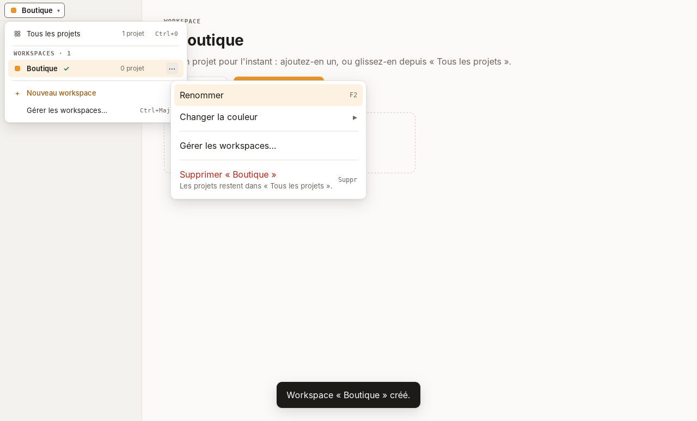 | 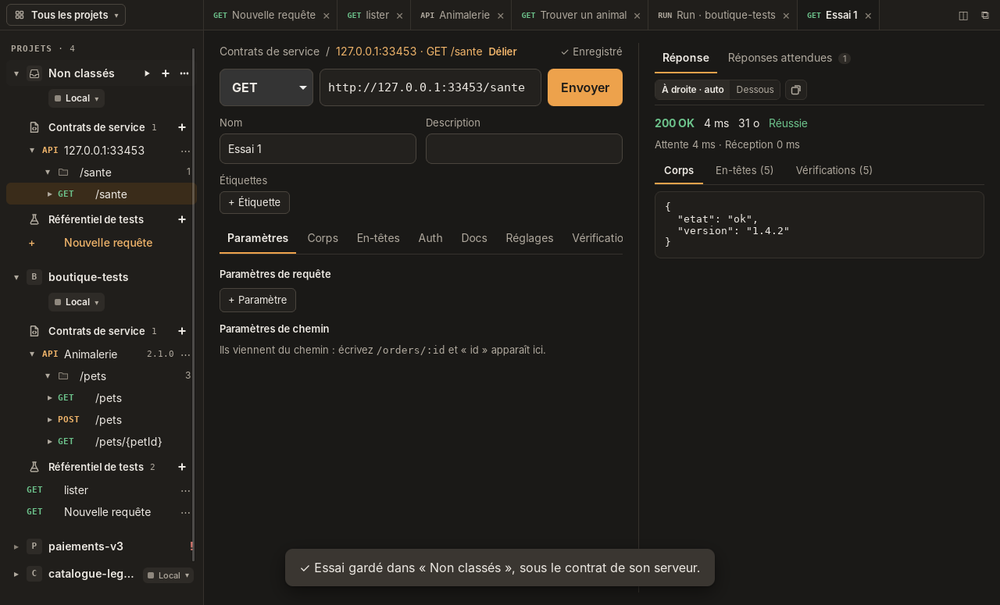 |

| ID           | Comportement                                                                                                                                      |
| ------------ | ------------------------------------------------------------------------------------------------------------------------------------------------- |
| P1, O8       | Premier lancement : le sélecteur sur « Tous les projets » ; Arnod propose d'essayer une étape ou de créer le premier projet (`~/arnod/<nom>`).    |
| P2, O8       | Nouveau projet depuis un workspace : rangé dans ce seul workspace, toujours visible dans « Tous les projets ».                                    |
| P5, P10      | Ouverture d'un projet ; un dossier déplacé ou supprimé hors d'Arnod est signalé.                                                                  |
| P6, P7       | Ajout d'un projet à d'autres workspaces, retrait d'un workspace avec « Annuler ».                                                                 |
| O1, O12, P11 | « Tous les projets » : chaque projet une fois, dernière exécution, « Oublier » avec « Annuler », import d'un projet ou d'une collection Bruno.    |
| S1, S2, R7   | Sélecteur en tête de la barre latérale : « Tous les projets » puis les workspaces (Ctrl+0…9) ; Arnod rouvre le dernier, gardé dans `arnod.json`.  |
| S3, S4, S5   | « + Nouveau workspace » ; « ⋯ », clic droit ou Maj+F10 sur un workspace : renommer (F2), couleur, gérer (Ctrl+Maj+W), supprimer avec « Annuler ». |
| S6           | Glisser une ligne de « Tous les projets » sur le sélecteur l'ouvre ; la déposer sur un workspace y ajoute le projet.                              |
| I1, I2, RC6  | Dans un projet déplié, « Contrats de service » puis « Référentiel de tests » sont précédés d'une icône, avec leur nombre et « + ».                |
| W6, O10      | « Ajouter un projet » à un workspace : créer, importer, ou reprendre des projets existants.                                                       |
| O11          | Gestion des workspaces : nom, couleur, projets, suppression avec « Annuler ».                                                                     |
| F4           | Fermeture propre par le menu **Fichier › Quitter** (`Ctrl+Q`) ou la croix de la fenêtre.                                                          |
| N7           | Thème clair ou sombre selon le système, police système.                                                                                           |

### Accueil, catalogue des étapes et Non classés

Cas A1 à A5, K1, K2 et N1 à N5 de [`docs/plan-accueil-non-classes.md`](docs/plan-accueil-non-classes.md) ;
étude du catalogue synchronisé dans [`docs/etude-catalogue-etapes.md`](docs/etude-catalogue-etapes.md).

| Accueil, formulaire REST ouvert                            | Essai gardé dans « Non classés »                                        |
| ---------------------------------------------------------- | ----------------------------------------------------------------------- |
| 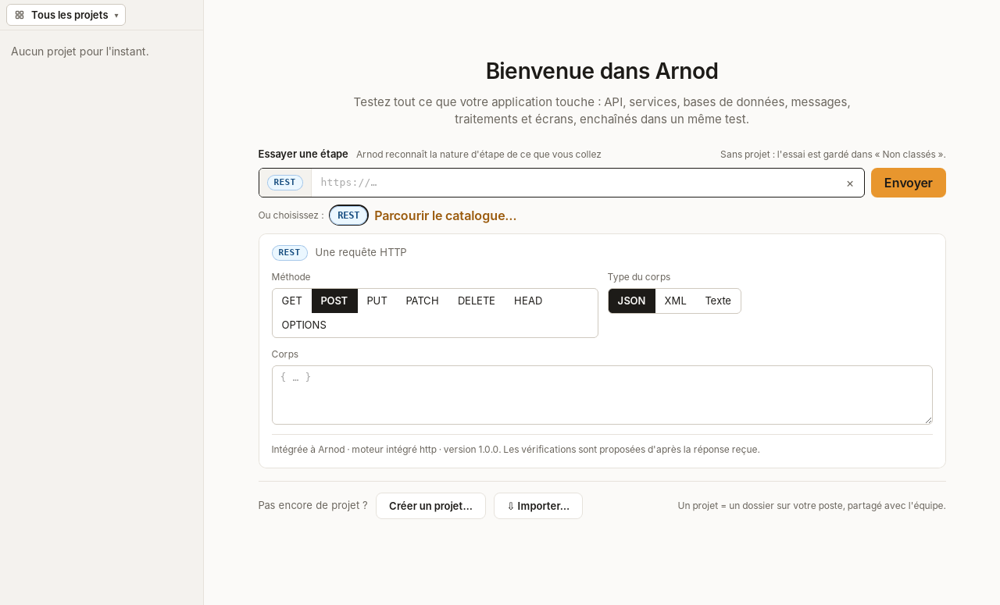       | 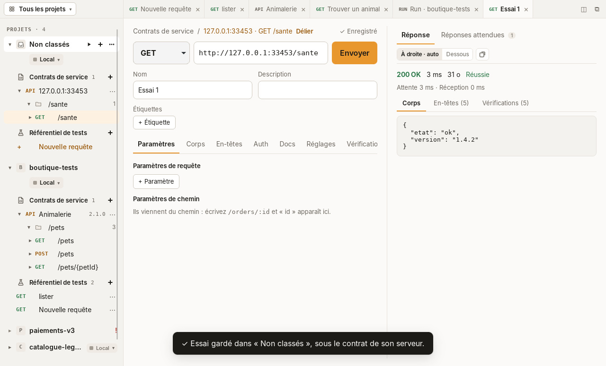       |
| 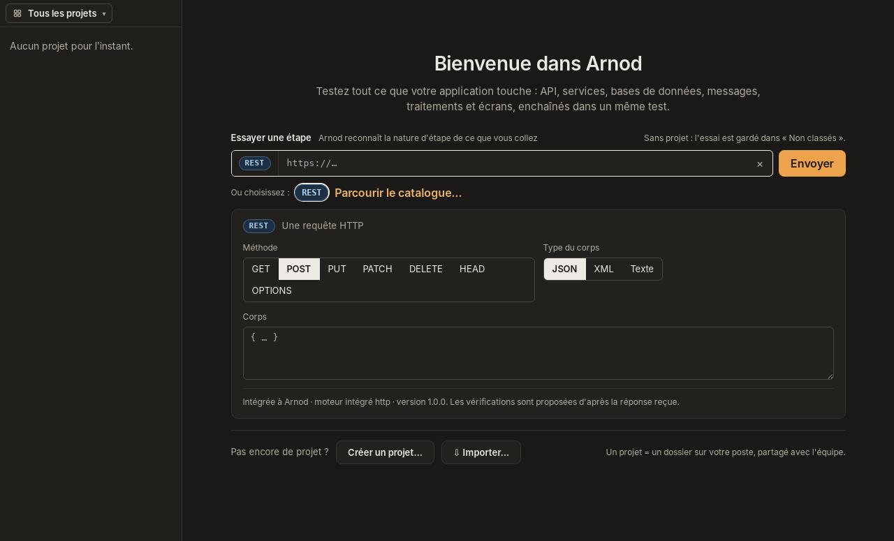 |  |

| ID     | Comportement                                                                                                                                                          |
| ------ | --------------------------------------------------------------------------------------------------------------------------------------------------------------------- |
| A1, A2 | « Essayer une étape » : une adresse collée est reconnue REST par le cœur, son formulaire s'ouvre sous l'entrée ; une méthode en tête (`POST https://…`) y passe.      |
| A3, A4 | Une pastille de nature ouvre son formulaire, généré depuis sa définition ; créer et importer se réduisent à une ligne ; Échap revient au départ.                      |
| A5, N1 | « Envoyer » crée au besoin le projet « Non classés » et y ouvre « Essai N » avec sa réponse, lié au contrat déduit du serveur (`contracts/<hôte>.yaml`, OpenAPI 3.1). |
| N2, N4 | Les essais suivants, depuis « Tous les projets », enrichissent le même contrat ; un contrat écrit à la main n'est jamais modifié.                                     |
| N3, N5 | « Non classés » : icône de bac, en tête de liste, hors workspaces ; recréé au besoin au prochain essai.                                                               |
| K1, K2 | « Parcourir le catalogue… » : natures d'étape, famille, moteur, version et ce qu'Arnod reconnaît ; REST est intégrée à Arnod.                                         |

### Fenêtres et zones

Cas F1 à F14 de [`docs/plan-fenetres-zones.md`](docs/plan-fenetres-zones.md) (maquette « Fenêtres
et zones »).

| Deux zones côte à côte                                      | Zone ouverte dans sa fenêtre                                          |
| ----------------------------------------------------------- | --------------------------------------------------------------------- |
| 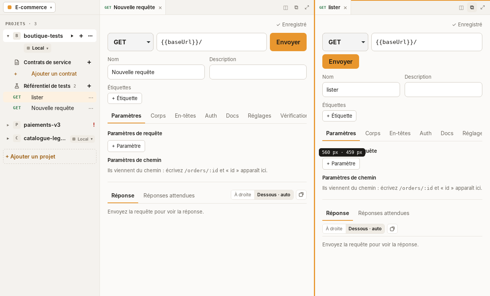       | 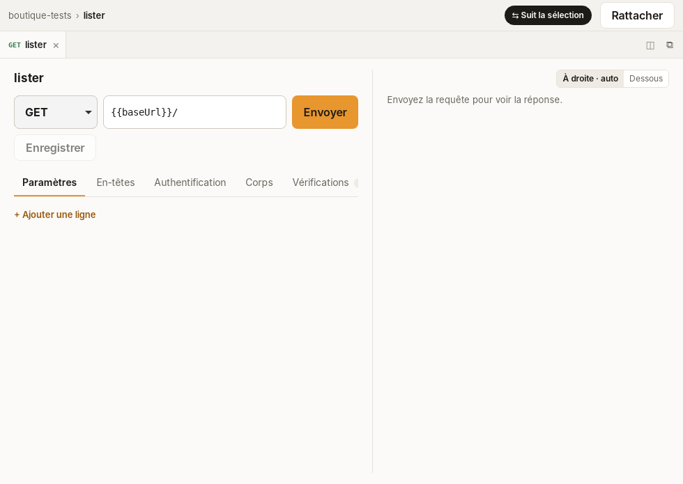       |
| 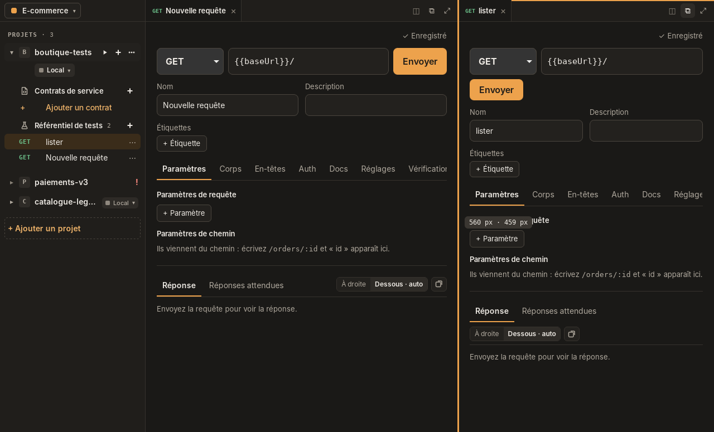 | 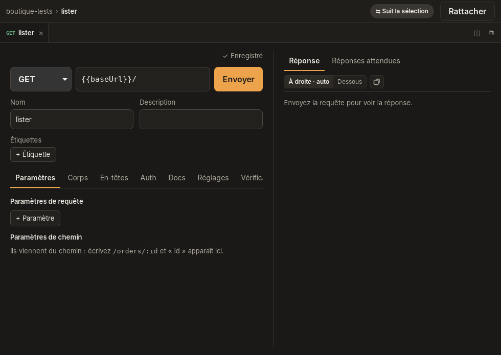 |

| ID       | Comportement                                                                                                                           |
| -------- | -------------------------------------------------------------------------------------------------------------------------------------- |
| F1       | Une requête choisie dans la barre latérale s'ouvre en onglet, une seule fois par fenêtre ; ×, Suppr ou `Ctrl+W` la ferme, enregistrée. |
| F2, F3   | Diviser : glisser un onglet sur le bord droit ou bas d'une zone, ◫, ou le menu de l'onglet (clic droit, Maj+F10) ; au plus 4 zones.    |
| F4, F5   | Séparations et barre latérale redimensionnables : taille affichée, double-clic pour des parts égales, flèches ou `Alt+Maj+flèches`.    |
| F6       | Résultat d'une requête à droite ou dessous ; en automatique, il passe dessous quand la zone est étroite.                               |
| F7       | Menu **Fenêtre › Dispositions** : 1 zone, 2 colonnes, 2 lignes, 3 ou 4 zones, onglets conservés.                                       |
| F8, F12  | ⧉ ou `Ctrl+Maj+O` ouvre la zone dans sa fenêtre ; un onglet glissé hors de la fenêtre s'ouvre là ; « Rattacher » le ramène.            |
| F9, F10  | Barre latérale détachable (`Ctrl+Maj+D`) : elle pilote les fenêtres qui suivent la sélection ; une fenêtre peut être épinglée.         |
| F11      | Catalogue, arborescences, requêtes enregistrées et environnements se mettent à jour dans toutes les fenêtres.                          |
| F13, F14 | Zones, tailles et fenêtres détachées rouvertes au démarrage (`windows.json`) ; ⤢ agrandit une zone.                                    |
| D1 à D7  | ⧉ dans le résultat d'une requête : le résultat a sa fenêtre et suit la requête active ; l'onglet de la requête garde l'éditeur seul.   |

### Contrats de services

Cas C1 à C12 de [`docs/plan-contrats-services.md`](docs/plan-contrats-services.md), RC1 à RC9 de
[`docs/plan-requetes-dans-contrats.md`](docs/plan-requetes-dans-contrats.md).

| Thème clair                                                          | Thème sombre                                                               |
| -------------------------------------------------------------------- | -------------------------------------------------------------------------- |
| 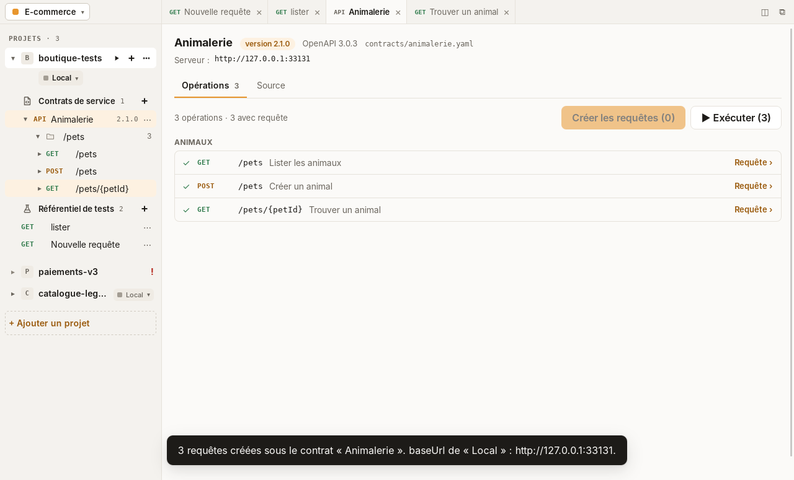 | 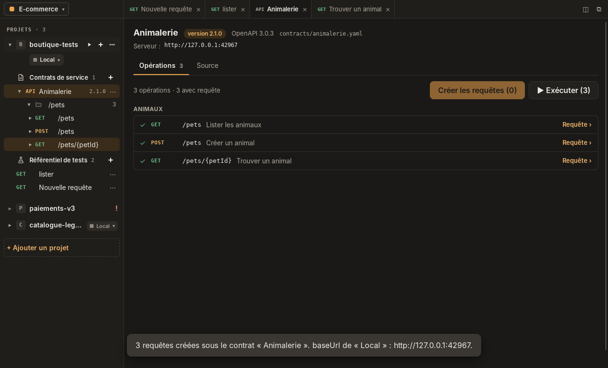 |

| ID       | Comportement                                                                                                                                                                           |
| -------- | -------------------------------------------------------------------------------------------------------------------------------------------------------------------------------------- |
| C1 à C4  | « + Ajouter un contrat » : importer un fichier, coller un contrat, le lire à une adresse ou en créer un vide ; OpenAPI 3.0, 3.1 ou Swagger 2.0, JSON ou YAML, rangé dans `contracts/`. |
| C5       | Onglet du contrat : version, format, serveurs, opérations groupées par tag, couverture « n opérations · m avec requête ».                                                              |
| C6, C7   | « Créer les requêtes » : une requête prête à envoyer par opération cochée (exemples, authentification, vérifications), liée au contrat ; `baseUrl` vide prend le serveur du contrat.   |
| C8       | Toute requête liée est vérifiée « conforme au contrat » : statut prévu et corps conforme au schéma, avec le chemin du premier écart ; « Délier » retire le lien.                       |
| C9       | Vue « Source » : texte modifiable, enregistré seulement s'il reste un contrat lisible (Ctrl+S), ou remplacé par un fichier.                                                            |
| C10      | « Exécuter » lance le run des requêtes du contrat.                                                                                                                                     |
| C11, C12 | Contrat mis à la corbeille ; requêtes dont l'opération a disparu signalées « hors contrat ».                                                                                           |
| RC1, RC2 | Dans la barre latérale, un contrat se déplie en ressources, opérations et requêtes ; un clic sur une opération ouvre son endpoint.                                                     |
| RC3, RC4 | Une opération sans requête est estompée : un clic crée sa requête et l'ouvre ; la requête active est révélée sous son contrat.                                                         |
| RC6, RC7 | Le référentiel de tests ne garde que les requêtes sans contrat ; « Créer les requêtes » les range sous le contrat, qui se déplie.                                                      |

### Barre latérale du projet

Cas B1 à B6 de [`docs/plan-barre-laterale-projet.md`](docs/plan-barre-laterale-projet.md).

| ID     | Comportement                                                                                                                           |
| ------ | -------------------------------------------------------------------------------------------------------------------------------------- |
| B1, B5 | La ligne du projet porte ▶ (exécuter), + (ajouter) et ⋯ ; un projet replié montre son environnement à droite de son nom.               |
| B2     | Une pastille sous le nom ouvre le menu des environnements : couleur, adresse, protégé, gestion et création.                            |
| B3, B4 | « + » : nouvelle requête, dossier, contrat, environnement ; un projet vide propose « + Nouvelle requête » et « + Ajouter un contrat ». |
| B6     | Ctrl+N crée une requête, Ctrl+Maj+E ouvre les environnements du projet sélectionné.                                                    |

### Configuration d'un endpoint

Cas EP1 à EP10 de [`docs/plan-configuration-endpoint.md`](docs/plan-configuration-endpoint.md)
(maquette « Contrats de service », options a et a2).

| ID       | Comportement                                                                                                                                                     |
| -------- | ---------------------------------------------------------------------------------------------------------------------------------------------------------------- |
| EP1      | Méthode, adresse, nom, description et étiquettes modifiés sur place ; enregistrement automatique (« ✓ Enregistré »).                                             |
| EP2      | Paramètres de requête décrits ; paramètres de chemin tirés de l'adresse (`/orders/:id`).                                                                         |
| EP3      | Corps JSON, XML, texte ou formulaire, en variantes nommées : la sélectionnée part à l'envoi.                                                                     |
| EP4, EP5 | En-têtes décrits et en-têtes hérités ; authentification héritée du dossier ou de la collection, aucune, Basic, Bearer ou clé d'API, avec une note.               |
| EP6, EP7 | Documentation en Markdown ; réglages (délai, redirections, encodage) hérités ou propres.                                                                         |
| EP8, EP9 | Réponses attendues : ajouter, dupliquer, supprimer avec « Annuler », modifier (code, texte, nom, description, en-têtes, corps) ou reprendre la dernière réponse. |
| EP10     | Un endpoint créé depuis un contrat reçoit ses paramètres de chemin et une réponse attendue par code documenté.                                                   |

### Format des fichiers : OpenCollection

Cas S1 à S8 de [`docs/plan-opencollection.md`](docs/plan-opencollection.md). Les fichiers d'un
projet suivent strictement [OpenCollection](https://spec.opencollection.com) 1.0.0 : chaque
fichier écrit est validé contre le schéma officiel, conservé dans
[`docs/opencollection/`](docs/opencollection/opencollection-v1.0.0.schema.json), et rien n'est
écrit s'il ne l'est pas.

```text
boutique-tests/
  opencollection.yml      racine : nom, extensions.arnod (identifiant, ordre des environnements)
  environments/local.yml  variables ; une variable locale est une variable secrète
  contracts/petstore.yaml contrats OpenAPI, tels quels
  Clients/lister.yml      une requête : info, http, runtime.assertions, settings
```

| ID     | Comportement                                                                                                                                   |
| ------ | ---------------------------------------------------------------------------------------------------------------------------------------------- |
| S1, S5 | Un projet est un dossier contenant `opencollection.yml` ; une collection Bruno s'ajoute comme projet existant.                                 |
| S2     | Enregistrer ne change que ce qu'Arnod gère : scripts, exemples, documentation, descriptions, autres authentifications et corps sont conservés. |
| S3     | Vérifications avec les 28 opérateurs d'OpenCollection et de Bruno (`eq`, `lt`, `isDefined`, `between`…), activables une à une.                 |
| S6     | Un projet d'une version précédente d'Arnod (`arnod.yml`) est converti à l'ouverture, une fois, sans perte.                                     |
| S7     | Lien au contrat écrit en étiquette (`contract:contracts/petstore.yaml#GET /pets`).                                                             |
| S8     | Paramètres de chemin (`:id`) remplacés à l'envoi.                                                                                              |

Pile : [Tauri 2](https://v2.tauri.app) (cœur Rust, WebView2 sous Windows, WebKitGTK sous
Linux), Vue 3, TypeScript strict, Vite, Pinia. Les règles d'architecture et les conventions
sont dans [`CLAUDE.md`](CLAUDE.md).

## Prérequis

- Node.js 22 ou plus récent.
- Rust stable 1.90 ou plus récent (`rustup`).
- **Windows** : Microsoft C++ Build Tools et WebView2 (présent sur Windows 10 22H2 et 11).
- **Linux** (Debian/Ubuntu) :

  ```sh
  sudo apt install libwebkit2gtk-4.1-dev build-essential curl wget file \
    libxdo-dev libssl-dev librsvg2-dev
  ```

## Développement

```sh
npm ci
npm run tauri dev
```

| Commande                                    | Rôle                                                              |
| ------------------------------------------- | ----------------------------------------------------------------- |
| `npm run check`                             | Toutes les vérifications de la CI hors build, avant chaque commit |
| `npm test`                                  | Tests frontend (Vitest)                                           |
| `npm run lint` / `npm run typecheck`        | ESLint / vue-tsc                                                  |
| `npm run format` / `npm run format:check`   | Prettier                                                          |
| `cargo test` (dans `src-tauri/`)            | Tests du cœur Rust                                                |
| `cargo clippy --all-targets -- -D warnings` | Lint Rust, zéro avertissement                                     |

## Build

```sh
npm run tauri build
```

| Système | Paquet produit                                                            |
| ------- | ------------------------------------------------------------------------- |
| Windows | `src-tauri/target/release/bundle/nsis/Arnod_<version>_x64-setup.exe`      |
| Linux   | `src-tauri/target/release/bundle/appimage/Arnod_<version>_amd64.AppImage` |

La CI construit les deux paquets à chaque pull request et les publie comme artefacts
(onglet **Actions** › exécution › **Artifacts**).

### Taille des paquets (cible N3 : installeur < 15 Mo)

| Paquet                    | Taille                         | Mesure                           |
| ------------------------- | ------------------------------ | -------------------------------- |
| Installeur Windows (NSIS) | **1,17 Mo** (1 167 097 octets) | CI `windows-latest`, v0.0.1      |
| AppImage Linux            | 80,4 Mo (76,6 Mio)             | Ubuntu 24.04, build local v0.0.1 |

1 Mo = 1 000 000 octets. La CI recalcule ces tailles à chaque build (résumé de
l'exécution) et échoue si l'installeur Windows dépasse 15 Mo (`scripts/bundle-size.mjs`).
L'AppImage embarque WebKitGTK et ses dépendances, d'où sa taille ; la cible N3 vise
l'installeur Windows, qui s'appuie sur le WebView2 du système.

## Publier une version

Les versions suivent [SemVer](https://semver.org/lang/fr/). `Develop` reçoit les pull requests,
`main` porte les versions publiées.

1. **Passer à la nouvelle version** par une pull request vers `Develop` (`chore: version X.Y.Z`) :
   `npm version X.Y.Z --no-git-tag-version` (`package.json` et `package-lock.json`), puis
   `version` dans `src-tauri/Cargo.toml` et `src-tauri/tauri.conf.json`, puis
   `cargo update -p arnod --offline` dans `src-tauri/` (`Cargo.lock`).
   `node scripts/check-version.mjs` vérifie que les six sources concordent ; `npm run check` et
   la CI le lancent aussi.
2. **Fusionner `Develop` dans `main`** avec un commit de merge.
3. **Poser le tag sur `main`** et le pousser :
   `git tag -a vX.Y.Z -m "Arnod X.Y.Z" && git push origin vX.Y.Z`.
4. **La CI publie la release** : build, tests, contrôle tag = version, puis release GitHub avec
   l'installeur Windows, l'AppImage et des notes générées à partir des pull requests. Ne pas
   créer la release à la main ; si elle existe déjà, la CI y ajoute les paquets.

## Installation

### Windows, sans droits administrateur

1. Télécharger `Arnod_<version>_x64-setup.exe` depuis les
   [releases](https://github.com/juliencorre/Arnod/releases) et le lancer depuis un compte
   standard. L'installeur est en mode `currentUser` : il ne demande pas d'élévation UAC.
2. SmartScreen peut afficher « Windows a protégé votre ordinateur », l'exécutable n'étant pas
   signé : **Informations complémentaires › Exécuter quand même**.
3. Arnod est installé dans **`%LOCALAPPDATA%\Arnod`** avec un raccourci dans le menu Démarrer.
   (Le PRD, N2, visait `%LOCALAPPDATA%\Programs\Arnod` : le modèle NSIS de Tauri 2 en mode
   `currentUser` impose `%LOCALAPPDATA%\<productName>` et n'offre aucune option pour le
   changer, hormis un modèle `.nsi` complet personnalisé.)
4. Désinstallation : **Paramètres › Applications › Arnod › Désinstaller** (sans droits
   administrateur, l'entrée est enregistrée dans `HKCU`).

WebView2 : s'il est absent, l'installeur télécharge son bootstrapper (connexion requise).
Pour un poste hors ligne, passer `bundle.windows.webviewInstallMode` à `embedBootstrapper`
dans `src-tauri/tauri.conf.json` (+1,8 Mo).

Installation silencieuse : `Arnod_<version>_x64-setup.exe /S`.

### Linux (AppImage)

Télécharger `Arnod_<version>_amd64.AppImage` depuis les
[releases](https://github.com/juliencorre/Arnod/releases), puis :

```sh
chmod +x Arnod_<version>_amd64.AppImage
./Arnod_<version>_amd64.AppImage
```

Aucun droit root n'est nécessaire. Sans FUSE (conteneurs, certaines distributions),
lancer avec `APPIMAGE_EXTRACT_AND_RUN=1`.

## Vérifications

La CI (`.github/workflows/build.yml`, Windows et Linux) exécute lint, format, typecheck,
Vitest, clippy, `cargo test`, le build puis un test de fumée :

- **Windows** (`scripts/smoke-windows.ps1`) : manifeste de l'installeur en `asInvoker`
  (aucune élévation demandée), installation silencieuse dans `%LOCALAPPDATA%\Arnod`,
  raccourci du menu Démarrer, entrée de désinstallation dans `HKCU`, lancement, attente de
  « Bienvenue dans Arnod » dans la page (UI Automation), capture publiée en artefact,
  fermeture par la croix (code 0), désinstallation silencieuse.
- **Linux** (`scripts/smoke-linux.sh`) : AppImage construit sur Ubuntu 22.04, lancé sous
  Xvfb, capture d'écran publiée en artefact, fermeture par `Ctrl+Q` (code 0).
- **E2E** (`e2e/`, voir [`e2e/README.md`](e2e/README.md)) : parcours complets sur
  l'application réelle (binaire debug, cœur Rust, vrai disque) via `tauri-driver`, sous Xvfb,
  en thème clair puis sombre ; captures publiées en artefact.

Lancer les tests e2e en local (Linux) :

```sh
sudo apt install webkit2gtk-driver xvfb
cargo install tauri-driver --locked
npm run build:e2e                      # binaire debug avec l'interface embarquée
xvfb-run -a npm run test:e2e           # ARNOD_E2E_THEME=dark pour le thème sombre
```

Restent à vérifier à la main (le runner Windows CI est administrateur) :

- [ ] Installation et désinstallation sur un **compte Windows standard**, sans invite UAC.
- [ ] Installation sur un Windows 10 sans WebView2.
- [ ] Démarrage à froid < 2 s (N4) et mémoire au repos < 150 Mo (N5) sur le poste de référence.

## Licence

[MIT](LICENSE)
