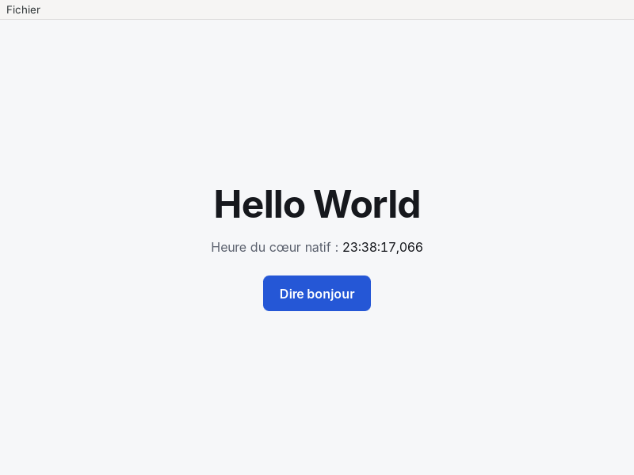
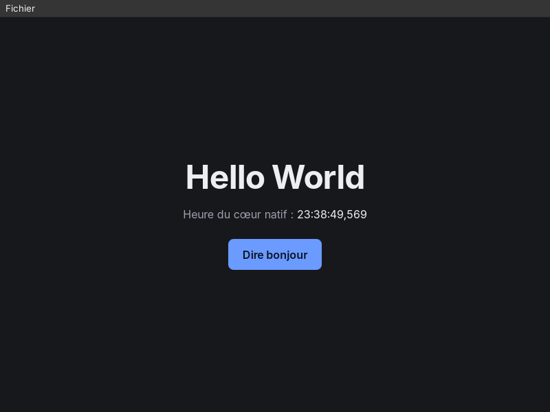

# Arnod

Application de bureau de test d'API, destinée à remplacer SoapUI et Bruno.

> **Statut : squelette technique.** Ce dépôt valide la chaîne complète (code, build,
> installation Windows sans droits administrateur, lancement, IPC interface ↔ cœur
> natif) avant toute fonctionnalité. Voir [`PRD-squelette.md`](PRD-squelette.md).

| Thème clair                                      | Thème sombre                                           |
| ------------------------------------------------ | ------------------------------------------------------ |
|  |  |

_AppImage release sous Linux (WebKitGTK). Le thème suit la préférence du système._

## Ce que fait le squelette

| ID  | Comportement                                                                             |
| --- | ---------------------------------------------------------------------------------------- |
| F1  | La fenêtre affiche « Hello World » au démarrage.                                         |
| F2  | Ce texte provient de la commande Rust `hello`, appelée par l'interface via IPC.          |
| F3  | Le bouton « Dire bonjour » rappelle la commande et affiche l'heure du cœur natif.        |
| F4  | Fermeture propre par le menu **Fichier › Quitter** (`Ctrl+Q`) ou la croix de la fenêtre. |
| N7  | Thème clair ou sombre selon le système, police système.                                  |

Pile : [Tauri 2](https://v2.tauri.app) (cœur Rust, WebView2 sous Windows, WebKitGTK sous
Linux), Vue 3, TypeScript strict, Vite, Pinia. Les règles d'architecture et les conventions
sont dans [`CLAUDE.md`](CLAUDE.md).

## Prérequis

- Node.js 22 ou plus récent.
- Rust stable 1.90 ou plus récent (`rustup`).
- **Windows** : Microsoft C++ Build Tools et WebView2 (présent sur Windows 10 22H2 et 11).
- **Linux** (Debian/Ubuntu) :

  ```sh
  sudo apt install libwebkit2gtk-4.1-dev build-essential curl wget file \
    libxdo-dev libssl-dev librsvg2-dev
  ```

## Développement

```sh
npm ci
npm run tauri dev
```

| Commande                                    | Rôle                          |
| ------------------------------------------- | ----------------------------- |
| `npm test`                                  | Tests frontend (Vitest)       |
| `npm run lint` / `npm run typecheck`        | ESLint / vue-tsc              |
| `npm run format` / `npm run format:check`   | Prettier                      |
| `cargo test` (dans `src-tauri/`)            | Tests du cœur Rust            |
| `cargo clippy --all-targets -- -D warnings` | Lint Rust, zéro avertissement |

## Build

```sh
npm run tauri build
```

| Système | Paquet produit                                                        |
| ------- | --------------------------------------------------------------------- |
| Windows | `src-tauri/target/release/bundle/nsis/Arnod_0.1.0_x64-setup.exe`      |
| Linux   | `src-tauri/target/release/bundle/appimage/Arnod_0.1.0_amd64.AppImage` |

La CI construit les deux paquets à chaque pull request et les publie comme artefacts
(onglet **Actions** › exécution › **Artifacts**).

### Taille des paquets (cible N3 : installeur < 15 Mo)

| Paquet                    | Taille                         | Mesure                           |
| ------------------------- | ------------------------------ | -------------------------------- |
| Installeur Windows (NSIS) | **1,17 Mo** (1 167 097 octets) | CI `windows-latest`, v0.1.0      |
| AppImage Linux            | 80,4 Mo (76,6 Mio)             | Ubuntu 24.04, build local v0.1.0 |

1 Mo = 1 000 000 octets. La CI recalcule ces tailles à chaque build (résumé de
l'exécution) et échoue si l'installeur Windows dépasse 15 Mo (`scripts/bundle-size.mjs`).
L'AppImage embarque WebKitGTK et ses dépendances, d'où sa taille ; la cible N3 vise
l'installeur Windows, qui s'appuie sur le WebView2 du système.

## Installation

### Windows, sans droits administrateur

1. Lancer `Arnod_0.1.0_x64-setup.exe` depuis un compte standard. L'installeur est en mode
   `currentUser` : il ne demande pas d'élévation UAC.
2. SmartScreen peut afficher « Windows a protégé votre ordinateur », l'exécutable n'étant pas
   signé : **Informations complémentaires › Exécuter quand même**.
3. Arnod est installé dans **`%LOCALAPPDATA%\Arnod`** avec un raccourci dans le menu Démarrer.
   (Le PRD, N2, visait `%LOCALAPPDATA%\Programs\Arnod` : le modèle NSIS de Tauri 2 en mode
   `currentUser` impose `%LOCALAPPDATA%\<productName>` et n'offre aucune option pour le
   changer, hormis un modèle `.nsi` complet personnalisé.)
4. Désinstallation : **Paramètres › Applications › Arnod › Désinstaller** (sans droits
   administrateur, l'entrée est enregistrée dans `HKCU`).

WebView2 : s'il est absent, l'installeur télécharge son bootstrapper (connexion requise).
Pour un poste hors ligne, passer `bundle.windows.webviewInstallMode` à `embedBootstrapper`
dans `src-tauri/tauri.conf.json` (+1,8 Mo).

Installation silencieuse : `Arnod_0.1.0_x64-setup.exe /S`.

### Linux (AppImage)

```sh
chmod +x Arnod_0.1.0_amd64.AppImage
./Arnod_0.1.0_amd64.AppImage
```

Aucun droit root n'est nécessaire. Sans FUSE (conteneurs, certaines distributions),
lancer avec `APPIMAGE_EXTRACT_AND_RUN=1`.

## Vérifications

La CI (`.github/workflows/build.yml`, Windows et Linux) exécute lint, format, typecheck,
Vitest, clippy, `cargo test`, le build puis un test de fumée :

- **Windows** (`scripts/smoke-windows.ps1`) : manifeste de l'installeur en `asInvoker`
  (aucune élévation demandée), installation silencieuse dans `%LOCALAPPDATA%\Arnod`,
  raccourci du menu Démarrer, entrée de désinstallation dans `HKCU`, lancement, attente de
  « Hello World » dans la page (UI Automation), capture publiée en artefact, fermeture par la
  croix (code 0), désinstallation silencieuse.
- **Linux** (`scripts/smoke-linux.sh`) : AppImage construit sur Ubuntu 22.04, lancé sous
  Xvfb, capture d'écran publiée en artefact, fermeture par `Ctrl+Q` (code 0).

Restent à vérifier à la main (le runner Windows CI est administrateur) :

- [ ] Installation et désinstallation sur un **compte Windows standard**, sans invite UAC.
- [ ] Installation sur un Windows 10 sans WebView2.
- [ ] Démarrage à froid < 2 s (N4) et mémoire au repos < 150 Mo (N5) sur le poste de référence.

## Licence

[MIT](LICENSE)
