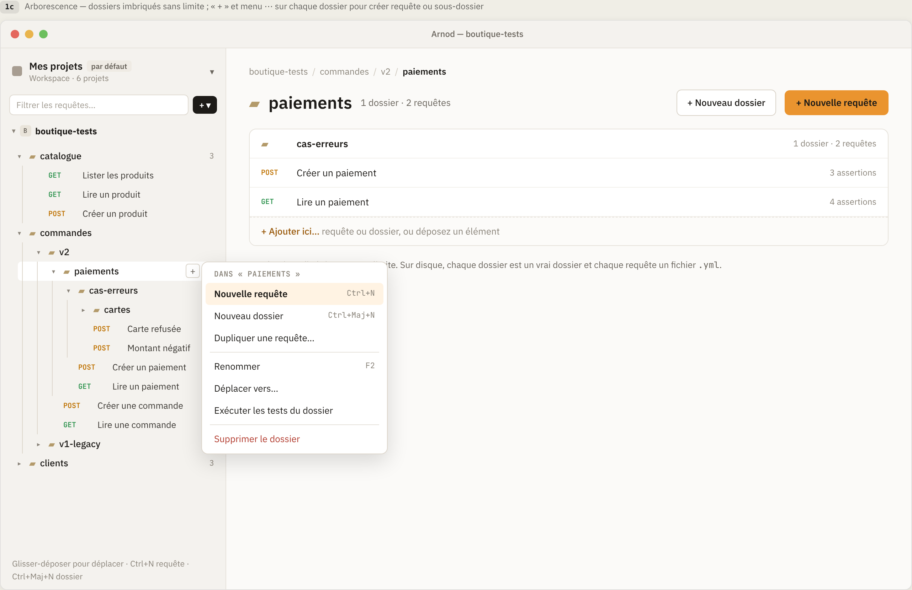
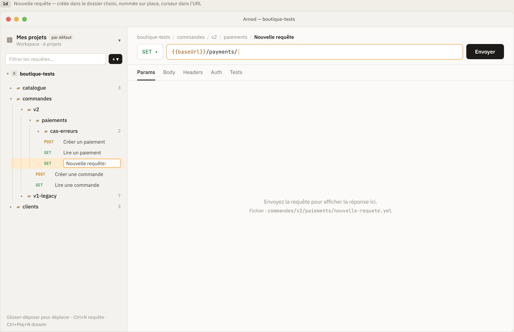
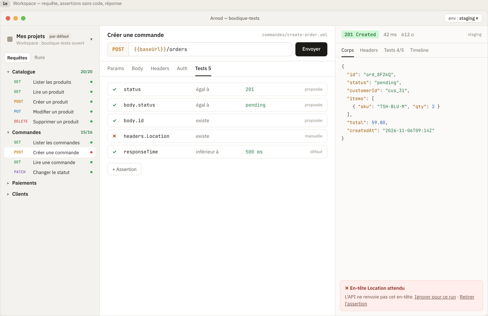
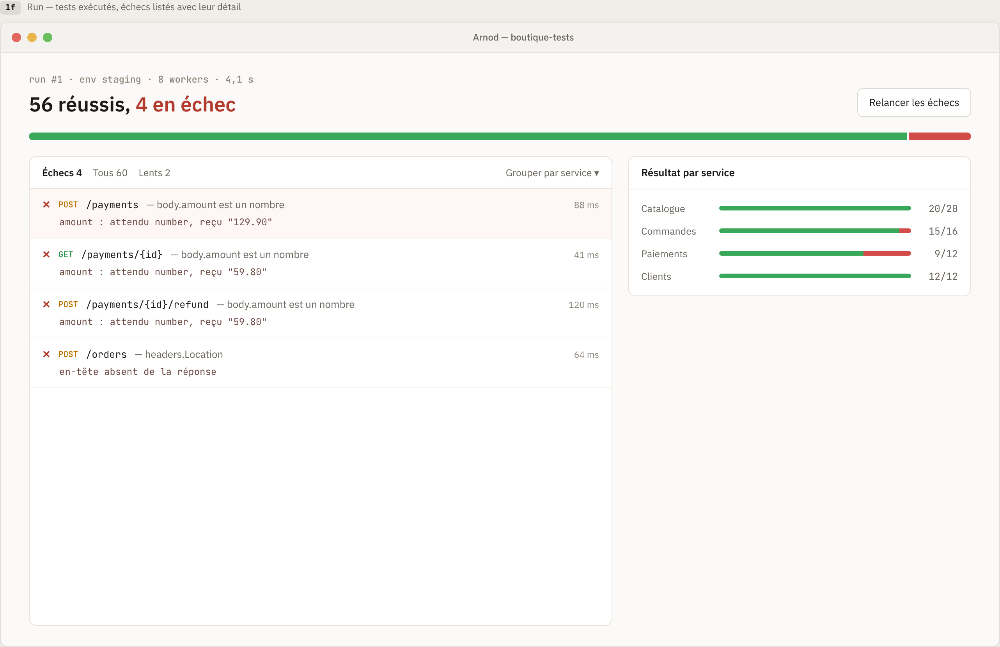

# Plan - Premier usage : de la création du projet au premier run

**Version** 0.1 · **Date** 2026-11-08 · **Statut** Décisions prises (§ 11) · **Base** version 0.0.2

Plan d'implémentation de la suite du premier usage : **ranger ses requêtes dans une arborescence**,
**écrire et envoyer une requête**, **vérifier la réponse sans code**, **changer d'environnement**
et **lancer les tests d'un dossier**. Il part de la version 0.0.2 (projets et workspaces livrés,
voir [`plan-projets-workspaces.md`](plan-projets-workspaces.md)) et respecte les règles de
[`CLAUDE.md`](../CLAUDE.md).

Source : maquette Claude Design « Arnod - Premier usage »
([lien](https://claude.ai/code/artifact/a9ee8986-2c7c-4be7-8600-fb3460033bbe)), écrans 1c à 1f,
complétés par les pages « Environnements », « Exécution », « Référentiel de tests » et
« Authentification et Préférences » de la même maquette. Les écrans 1c à 1f sont capturés dans
[`docs/maquettes/`](maquettes/).

> **Écarts entre les captures du dépôt et la maquette actuelle.** Les captures 1c à 1f datent de
> la première version de la maquette. Depuis, la maquette a changé sur quatre points, que ce plan
> suit : l'**environnement appartient au projet** (sélecteur sous le nom du projet dans la barre
> latérale et pastille à côté d'« Envoyer », plus de sélecteur dans la barre de titre) ; la
> **commande `arnod`** remplace toute mention de CI ; les environnements sont une **chaîne
> ordonnée** propre au projet ; les **assertions sont proposées** d'après la première réponse.
> Les captures seront remplacées par celles de la maquette actuelle à la tâche T1.

## 1. Objectif

À la fin de ce plan, Arnod :

- affiche dans la barre latérale l'arborescence du projet ouvert : dossiers imbriqués sans limite
  et requêtes, avec filtre, création, renommage, déplacement et suppression ;
- range chaque requête dans un fichier YAML lisible, chaque dossier étant un vrai dossier du
  projet, prêt à versionner avec Git ;
- permet d'écrire une requête (méthode, adresse, paramètres, corps, en-têtes, authentification
  Basic, Bearer ou clé d'API) et de l'envoyer ;
- affiche la réponse : statut, durée, taille, corps, en-têtes, chronologie ;
- propose des vérifications d'après la réponse reçue, que l'on coche ou retire, sans écrire de
  code ;
- gère les environnements du projet (variables partagées ou locales, secrets gardés sur le poste)
  et en change depuis la barre latérale ou la pastille d'« Envoyer » ;
- exécute tous les tests d'un dossier ou du projet, affiche le résultat run par run, avec les
  échecs détaillés et un « Relancer les échecs » ;
- conserve la dernière exécution d'une session à l'autre.

## 2. Maquettes

| Écran | Capture                                                                     | Dans ce plan                                                                                          |
| ----- | --------------------------------------------------------------------------- | ----------------------------------------------------------------------------------------------------- |
| 1b    | [Projet créé](maquettes/1b-projet-cree.png)                                 | Complété : la vue projet vide devient l'arborescence et l'invite « Nouvelle requête »                 |
| 1c    | [Arborescence](maquettes/1c-arborescence.png)                               | Oui : dossiers, menu ⋯, vue d'un dossier, filtre, glisser-déposer                                     |
| 1d    | [Nouvelle requête](maquettes/1d-nouvelle-requete.png)                       | Oui : création sur place, curseur dans l'adresse                                                      |
| 1e    | [Requête, assertions, réponse](maquettes/1e-requete-assertions-reponse.png) | Oui, avec la pastille d'environnement à côté d'« Envoyer »                                            |
| 1f    | [Run](maquettes/1f-run.png)                                                 | Oui : résumé, échecs détaillés, résultat par dossier ; « workers » devient « requêtes en même temps » |
| -     | Page « Environnements » de la maquette                                      | Oui : liste ordonnée, variables, protection ; sans campagnes ni mocks                                 |
| -     | Page « Authentification et Préférences » (partie MVP)                       | Oui : Basic, Bearer, clé d'API ; pas d'OAuth 2, de certificat ni de WS-Security                       |

## 3. Modèle et règles

- **Requête** : un fichier `<nom-de-fichier>.yml` dans un dossier du projet. Elle porte un nom
  d'affichage, une méthode, une adresse, des paramètres, des en-têtes, un corps, une
  authentification et des vérifications.
- **Dossier** : un vrai dossier sous la racine du projet. L'arborescence de la barre latérale est
  exactement celle du disque.
- **Variable** : un nom et une valeur, utilisable partout par `{{nom}}`. Elle est **partagée**
  (versionnée avec le projet) ou **locale** (gardée sur le poste, jamais écrite dans le projet).
- **Environnement** : un jeu de variables nommé, propre au projet (Local, Recette, Pré-production…).
  Les environnements forment une chaîne ordonnée ; un environnement peut être **protégé**.
- **Vérification** (assertion) : une condition sur la réponse, sans code : cible, opérateur,
  valeur attendue. Elle est **proposée** (cochée d'après la réponse reçue), **manuelle** (ajoutée
  par l'utilisateur) ou **par défaut** (durée de réponse).
- **Run** : l'exécution de toutes les requêtes d'un dossier ou du projet sur un environnement.

Les règles vivent dans le cœur Rust, modules purs sans dépendance à Tauri, au réseau ni au disque,
avec au moins un test par règle.

| ID  | Règle                                                                                                                                                                                                                                                                                                                      |
| --- | -------------------------------------------------------------------------------------------------------------------------------------------------------------------------------------------------------------------------------------------------------------------------------------------------------------------------- |
| R1  | L'arborescence affichée est celle du disque : dossiers d'abord, puis requêtes, chacun par nom sans tenir compte de la casse. Les dossiers et fichiers cachés (point initial) et `arnod.yml` sont ignorés.                                                                                                                  |
| R2  | Un nom de requête ou de dossier suit R9 et R10 du plan des projets (1 à 64 caractères, nom de fichier valide sous Windows et Linux). Il est unique dans son dossier, sans tenir compte de la casse.                                                                                                                        |
| R3  | Le nom de fichier d'une requête est dérivé de son nom d'affichage (minuscules, sans accents, tirets) ; en cas de collision, un suffixe `-2`, `-3`… est ajouté. Renommer une requête ne renomme pas son fichier si celui-ci a été choisi à la main.                                                                         |
| R4  | Déplacer ou renommer un dossier ou une requête ne perd aucune vérification ni aucun réglage ; déplacer un dossier dans l'un de ses descendants est refusé.                                                                                                                                                                 |
| R5  | Supprimer un dossier ou une requête passe par la corbeille du système quand elle existe, sinon par une suppression définitive précédée d'une confirmation. Une notification propose « Annuler » dans le premier cas.                                                                                                       |
| R6  | `{{nom}}` est remplacé, dans l'adresse, les paramètres, les en-têtes, le corps et l'authentification, par la valeur de l'environnement actif. Une variable locale l'emporte sur une variable partagée du même nom. Une variable inconnue bloque l'envoi et est nommée dans le message.                                     |
| R7  | Un environnement a un nom unique dans le projet (sans tenir compte de la casse). Le dernier environnement utilisé est mémorisé par projet, sur ce poste uniquement. Le premier de la chaîne est proposé à l'ouverture si rien n'est mémorisé.                                                                              |
| R8  | Envoyer sur un environnement **protégé** une requête POST, PUT, PATCH ou DELETE demande une confirmation au moment de l'envoi ; GET, HEAD et OPTIONS partent directement.                                                                                                                                                  |
| R9  | Un secret (variable locale marquée secret, jeton, mot de passe) n'est jamais écrit dans un fichier du projet, ni dans la réponse affichée, ni dans le fichier de la dernière exécution : il est masqué (`••••`) partout.                                                                                                   |
| R10 | Les vérifications **proposées** sont calculées par le cœur d'après la réponse : statut égal au statut reçu, champs de premier niveau du corps JSON existants, champs scalaires égaux à leur valeur reçue sauf ceux qui varient (identifiants, dates). Rien n'est vérifié tant que l'utilisateur n'a pas envoyé la requête. |
| R11 | Une requête réussit si **toutes** ses vérifications réussissent. Sans aucune vérification, elle réussit si le statut est inférieur à 400. Un échec réseau (hôte inconnu, refus, délai dépassé) est un échec de la requête, jamais une erreur de l'application.                                                             |
| R12 | Le délai maximal d'une requête est de 30 s par défaut (réglable par requête). La réponse affichée est limitée à 5 Mo ; au-delà, elle est tronquée avec un avertissement, les vérifications portant sur la réponse entière.                                                                                                 |
| R13 | Un run exécute les requêtes d'un dossier dans l'ordre de l'arborescence, avec au plus 8 requêtes en même temps (réglable). Il est annulable ; une requête déjà partie va au bout.                                                                                                                                          |
| R14 | Un run garde, pour chaque requête : statut, durée, vérifications en échec avec valeur attendue et valeur reçue. Seul le dernier run de chaque projet est conservé, dans le dossier de données de l'application.                                                                                                            |
| R15 | « Relancer les échecs » exécute uniquement les requêtes en échec du dernier run, sur le même environnement, et remplace leurs résultats dans ce run.                                                                                                                                                                       |
| R16 | Une requête est « lente » quand sa durée dépasse sa vérification de durée (500 ms par défaut) ou, à défaut, le double de la médiane du run.                                                                                                                                                                                |

## 4. Cas d'usage

Priorités : **Must** (indispensable au lot), **Should** (attendu), **Could** (si le temps le
permet). Préfixes : **A** arborescence, **B** requête, **X** envoi et réponse, **V** vérifications,
**N** environnements, **L** lancement.

### 4.1 Arborescence



| ID  | Cas d'usage             | Écrans          | Comportement attendu                                                                                                                                                                                                    | Priorité |
| --- | ----------------------- | --------------- | ----------------------------------------------------------------------------------------------------------------------------------------------------------------------------------------------------------------------- | -------- |
| A1  | Afficher l'arborescence | 1c              | Sous le nom du projet, les dossiers (repliables, compteur de requêtes) et les requêtes (méthode colorée, nom). L'état replié ou déplié est mémorisé par projet. Le projet vide affiche « Nouvelle requête ».            | Must     |
| A2  | Ouvrir un dossier       | 1c              | Clic sur un dossier : vue du dossier (fil d'Ariane, « N dossiers · M requêtes », lignes avec nombre d'assertions, « + Nouveau dossier », « + Nouvelle requête », « + Ajouter ici… »).                                   | Must     |
| A3  | Créer un dossier        | 1c              | « + » sur la ligne, menu ⋯ ou Ctrl+Maj+N : le nom se saisit sur place, Entrée crée le dossier réel, Échap annule. Nom refusé : message sous le champ (R2).                                                              | Must     |
| A4  | Menu d'un dossier       | 1c              | « Nouvelle requête » (Ctrl+N), « Nouveau dossier », « Dupliquer une requête… », « Renommer » (F2), « Déplacer vers… », « Exécuter les tests du dossier » (L1), « Supprimer le dossier » (rouge).                        | Must     |
| A5  | Renommer                | 1c              | F2 ou menu : édition sur place. Renommer un dossier renomme le dossier sur disque (R4).                                                                                                                                 | Must     |
| A6  | Déplacer                | 1c              | Glisser-déposer dans l'arborescence, ou « Déplacer vers… » (liste de dossiers avec recherche), au clavier comme à la souris. Descendant interdit (R4).                                                                  | Should   |
| A7  | Supprimer               | 1c              | Selon R5 : notification avec « Annuler » (corbeille) ou confirmation (sans corbeille).                                                                                                                                  | Must     |
| A8  | Filtrer                 | 1c              | « Filtrer les requêtes… » : filtre par nom et par adresse ; les dossiers sans résultat disparaissent, les autres sont dépliés. Filtre d'affichage, sans commande Rust.                                                  | Should   |
| A9  | Dupliquer une requête   | 1c              | Menu : copie dans le même dossier, nom « <nom> (copie) », vérifications comprises (R2, R3).                                                                                                                             | Could    |
| A10 | Changement de disque    | (hors maquette) | Le projet est modifié hors d'Arnod (Git, explorateur) : l'arborescence se met à jour au retour dans la fenêtre et au bouton « Actualiser ». Un fichier illisible est listé « fichier illisible » sans bloquer le reste. | Must     |

### 4.2 Requête



| ID  | Cas d'usage               | Écrans          | Comportement attendu                                                                                                                                                                                            | Priorité |
| --- | ------------------------- | --------------- | --------------------------------------------------------------------------------------------------------------------------------------------------------------------------------------------------------------- | -------- |
| B1  | Créer une requête         | 1d              | Depuis le menu d'un dossier, « + Nouvelle requête » ou Ctrl+N : une ligne « Nouvelle requête » s'édite sur place, la requête GET `{{baseUrl}}/` est créée dans le dossier choisi, le curseur va dans l'adresse. | Must     |
| B2  | Éditer la requête         | 1d, 1e          | Méthode (GET, POST, PUT, PATCH, DELETE, HEAD, OPTIONS), adresse, onglets Paramètres, Corps, En-têtes, Authentification, Tests. Enregistrement automatique après 600 ms sans frappe, « ✓ Enregistré ».           | Must     |
| B3  | Paramètres et en-têtes    | 1d              | Tableau nom / valeur avec case d'activation ; les paramètres actifs sont ajoutés à l'adresse et l'adresse reste modifiable à la main (synchronisation dans les deux sens).                                      | Must     |
| B4  | Corps                     | 1d              | Aucun, JSON (mise en forme, erreur de syntaxe signalée sans bloquer), texte, formulaire (clé / valeur). L'en-tête `Content-Type` est proposé selon le type. Envoi de fichiers : lot suivant.                    | Must     |
| B5  | Authentification          | 1d              | Aucune, Basic, Bearer, clé d'API (en-tête ou paramètre). Les valeurs acceptent `{{variable}}`. Un secret saisi en clair est proposé comme variable locale (R9).                                                 | Must     |
| B6  | Variables dans l'adresse  | 1e              | `{{` ouvre la liste des variables de l'environnement actif ; une variable inconnue est soulignée. Survol : valeur résolue, secrets masqués.                                                                     | Should   |
| B7  | Requête non enregistrable | (hors maquette) | Disque plein, fichier verrouillé ou supprimé : bandeau « Non enregistré » avec « Réessayer » ; les modifications restent en mémoire.                                                                            | Must     |

### 4.3 Envoi et réponse



| ID  | Cas d'usage              | Écrans          | Comportement attendu                                                                                                                                                                                                  | Priorité |
| --- | ------------------------ | --------------- | --------------------------------------------------------------------------------------------------------------------------------------------------------------------------------------------------------------------- | -------- |
| X1  | Envoyer                  | 1d, 1e          | « Envoyer » ou Ctrl+Entrée : variables résolues (R6), requête partie depuis le cœur Rust ; « Annuler » pendant l'attente. Message clair pour variable inconnue, hôte introuvable, refus, certificat, délai.           | Must     |
| X2  | Lire la réponse          | 1e              | Panneau de droite : statut coloré (« 201 Created »), durée, taille, environnement utilisé. Onglets Corps (JSON mis en forme et coloré), En-têtes, Tests n/m, Chronologie (résolution, connexion, attente, réception). | Must     |
| X3  | Réponse non JSON ou vide | (hors maquette) | Texte brut affiché tel quel ; image ou binaire : taille et type, bouton « Enregistrer sous… » (dialogue natif depuis Rust). Réponse vide : « Aucun corps ».                                                           | Should   |
| X4  | Copier                   | 1e              | « Copier la commande » : l'équivalent `curl` (secrets masqués), « Copier le corps ».                                                                                                                                  | Could    |
| X5  | Dernière réponse gardée  | 1e              | La dernière réponse de chaque requête est conservée en mémoire pendant la session et réaffichée à la réouverture de la requête.                                                                                       | Should   |

### 4.4 Vérifications sans code

| ID  | Cas d'usage                      | Écrans | Comportement attendu                                                                                                                                                                                                  | Priorité |
| --- | -------------------------------- | ------ | --------------------------------------------------------------------------------------------------------------------------------------------------------------------------------------------------------------------- | -------- |
| V1  | Vérifications proposées          | 1e     | Après le premier envoi, l'onglet Tests liste les vérifications proposées (R10), cochées. « Cochées d'après la réponse reçue. Rien n'est vérifié tant que vous n'envoyez pas. » Décocher une ligne la retire.          | Must     |
| V2  | Ajouter une vérification         | 1e     | « + Assertion » : cible (statut, durée, `body.chemin`, `headers.nom`), opérateur (égal à, différent de, existe, contient, inférieur à, supérieur à, est un nombre, est un texte), valeur. Aucune syntaxe à apprendre. | Must     |
| V3  | Résultat d'une vérification      | 1e     | Après chaque envoi : ✓ ou ✗ devant chaque ligne ; l'échec est détaillé en bas de la réponse (« En-tête Location attendu — l'API ne renvoie pas cet en-tête »).                                                        | Must     |
| V4  | Ignorer ou retirer               | 1e     | Sur un échec : « Ignorer pour cette exécution » (la vérification reste enregistrée) ou « Retirer l'assertion ».                                                                                                       | Should   |
| V5  | Vérification de durée par défaut | 1e     | Chaque requête reçoit « durée inférieure à 500 ms » (origine « défaut »), modifiable et retirable.                                                                                                                    | Should   |

### 4.5 Environnements

| ID  | Cas d'usage                            | Écrans | Comportement attendu                                                                                                                                                                                    | Priorité |
| --- | -------------------------------------- | ------ | ------------------------------------------------------------------------------------------------------------------------------------------------------------------------------------------------------- | -------- |
| N1  | Créer le premier environnement         | 1b, 1e | À la création du projet, un environnement « Local » est créé avec la variable `baseUrl` vide ; au premier envoi sans `baseUrl`, la fenêtre demande l'adresse de base et la mémorise.                    | Must     |
| N2  | Choisir l'environnement                | 1e     | Sous le nom du projet (barre latérale) : `■ Recette ▾`, menu des environnements, « Gérer les environnements… ». À côté d'« Envoyer » : pastille identique, qui change l'environnement du projet (R7).   | Must     |
| N3  | Gérer les environnements               | -      | Page « Environnements » : liste ordonnée par glisser, nom, couleur, variables (nom, valeur, portée partagée ou locale), création (« Reprendre les variables de… »), suppression, case « Protégé » (R8). | Must     |
| N4  | Secrets                                | -      | Une variable locale marquée secret est rangée dans le coffre du système (Windows : gestionnaire d'identification), affichée `••••`, jamais exportée ni commitée (R9). « Retirer » l'efface du coffre.   | Must     |
| N5  | Confirmation sur environnement protégé | -      | Selon R8 : fenêtre « Envoyer POST /orders sur Pré-production ? » avec « Envoyer » et « Annuler ».                                                                                                       | Should   |
| N6  | Variable manquante                     | 1e     | Bandeau « Variable `token` absente de Recette » avec « Ajouter la variable » (ouvre N3 sur le bon environnement).                                                                                       | Should   |

### 4.6 Lancement



| ID  | Cas d'usage                      | Écrans          | Comportement attendu                                                                                                                                                                                               | Priorité |
| --- | -------------------------------- | --------------- | ------------------------------------------------------------------------------------------------------------------------------------------------------------------------------------------------------------------ | -------- |
| L1  | Exécuter un dossier ou le projet | 1c, 1f          | Menu du dossier (A4) ou bouton « Exécuter » sur le projet : run (R13) sur l'environnement du projet, avec progression « 23 / 60 » et « Annuler ». Environnement protégé : une seule confirmation pour tout le run. | Must     |
| L2  | Résumé du run                    | 1f              | « 56 réussis, 4 en échec », barre verte et rouge, ligne `run #1 · Recette · 8 requêtes en même temps · 4,1 s`.                                                                                                     | Must     |
| L3  | Liste des résultats              | 1f              | Onglets « Échecs », « Tous », « Lents » avec compteurs ; chaque échec montre méthode, adresse, vérification et valeur attendue ou reçue (« attendu number, reçu "129.90" ») ; clic : ouvre la requête.             | Must     |
| L4  | Résultat par dossier             | 1f              | Panneau « Résultat par dossier » : barre et « 15/16 » ; clic sur un dossier filtre la liste. « Grouper par dossier » ou « à plat ».                                                                                | Should   |
| L5  | Relancer les échecs              | 1f              | Bouton « Relancer les échecs » (R15).                                                                                                                                                                              | Must     |
| L6  | Dernier run gardé                | 2a, 2e          | Le dernier run est relu au redémarrage (R14) ; la colonne « Dernier run » du référentiel et les cartes de projet affichent « 56/60 · il y a 2 h ».                                                                 | Should   |
| L7  | Run vide                         | (hors maquette) | Dossier sans requête : « Aucune requête à exécuter » avec « + Nouvelle requête ».                                                                                                                                  | Must     |

## 5. Hors périmètre

Prévu dans des lots ultérieurs, selon la feuille de route de la maquette :

- Contrats de service (endpoints, corps et réponses attendus) et création de tests depuis un contrat.
- Onglets, zones côte à côte, fenêtres détachées.
- Suites en schéma (enchaîner des étapes, conditions, boucles, script), jeux de données, étapes manuelles.
- Produits, versions métier, exigences, campagnes, anomalies, tableau de bord.
- Import (Bruno, Postman, OpenAPI, SoapUI), GraphQL, SOAP, WebSocket, envoi de fichiers.
- Synchronisation avec l'équipe, commande `arnod`, thème sombre propre aux nouvelles vues
  (les jetons de `src/styles.css` suffisent).
- Authentification avancée (OAuth 2, certificat client, WS-Security), proxy, préférences.
- Mocks.
- Recherche globale `Ctrl+K`.

## 6. Architecture

La chaîne reste : composant Vue → store Pinia → `src/lib/ipc.ts` → commande Rust. **Toute la logique
métier (résolution des variables, envoi HTTP, vérifications, run) vit dans le cœur Rust** ; le
frontend affiche l'état renvoyé et ne fait que des filtres d'affichage.

### 6.1 Formats sur disque

Tous les fichiers portent `version: 1`. Un fichier d'une version plus récente est refusé avec la
nature `newerVersion`, sans écriture ; une version plus ancienne est migrée à la lecture.

**Requête** : `<dossier>/<nom-de-fichier>.yml`, lisible et stable pour Git (clés dans un ordre
fixe, une valeur par ligne, pas de réécriture si rien n'a changé).

```yaml
# Requête Arnod
version: 1
id: 4f0c…
name: Créer une commande
method: POST
url: "{{baseUrl}}/orders"
params: []
headers:
  - { name: Content-Type, value: application/json }
auth:
  type: bearer
  token: "{{token}}"
body:
  type: json
  content: |
    { "customerId": "cus_31", "items": [{ "sku": "TSH-BLU-M", "qty": 2 }] }
timeoutMs: 30000
assertions:
  - { id: a1, target: status, op: equals, value: 201, origin: proposed }
  - { id: a2, target: body.status, op: equals, value: pending, origin: proposed }
  - { id: a3, target: headers.Location, op: exists, origin: manual }
  - { id: a4, target: responseTime, op: lessThan, value: 500, origin: default }
```

L'`id` d'une requête permet de la retrouver après un déplacement ou un renommage hors d'Arnod ;
deux fichiers portant le même `id` (copie à la main) sont signalés et le second reçoit un
nouvel `id` à l'ouverture.

**Environnements** : `environments/<nom-de-fichier>.yml` à la racine du projet, un fichier par
environnement, et `environments/_order.yml` pour la chaîne. Seules les variables **partagées** y
figurent.

```yaml
# Environnement Arnod
version: 1
name: Recette fonctionnelle
color: bronze
protected: false
variables:
  - { name: baseUrl, value: "https://recette.boutique.dev" }
  - { name: clientId, value: cus_31 }
locals: [token] # noms des variables locales : les valeurs ne sont pas dans le projet
```

**Données locales** (jamais dans le projet), dans `app_local_data_dir()` :

- `arnod.json` (existant) : ajout, par projet, de `lastEnvironment` et de l'état replié de
  l'arborescence (`collapsed`). `version` passe à 2, migration à la lecture.
- `projects/<id-projet>/locals.json` : valeurs des variables locales **non secrètes**.
- Coffre du système : valeurs des variables locales **secrètes**, sous la clé `arnod/<id-projet>/<environnement>/<nom>`.
- `projects/<id-projet>/last-run.json` : dernier run (R14), secrets masqués (R9).

**Compatibilité Git.** Un dossier de projet circule entre des postes qui n'ont pas la même
version d'Arnod : une clé inconnue d'un fichier de version connue est conservée à la réécriture
(pas de perte silencieuse).

### 6.2 Cœur Rust

```
src-tauri/src/
  tree/                 Logique pure de l'arborescence
    mod.rs              Node (dossier | requête), tri R1, filtre
    names.rs            Noms de fichier dérivés (R3), collisions
    ops.rs              Créer, renommer, déplacer, dupliquer, supprimer (R2, R4, R5) sur un FS abstrait
    tests.rs
  request/              Modèle et vérifications, sans réseau
    model.rs            Request, Body, Auth, Assertion (miroir du YAML)
    file.rs             Lecture et écriture YAML (ordre stable, clés inconnues conservées)
    resolve.rs          {{variables}} (R6), masquage des secrets (R9)
    assertions.rs       Évaluation des opérateurs, vérifications proposées (R10, R11)
    tests.rs
  environment/          Modèle, chaîne ordonnée, portée, protection (R7, R8)
    mod.rs, file.rs, secrets.rs (trait SecretStore : coffre du système et faux pour les tests)
  http.rs               Client HTTP : envoi, délai, annulation, chronologie, troncature (R12)
  run.rs                Run : ordre, concurrence, annulation, relance des échecs, agrégats (R13 à R16)
  run_store.rs          last-run.json
  commands/
    tree.rs             Façades de l'arborescence
    requests.rs         request_read, request_save, request_send
    environments.rs     Façades des environnements et des variables
    runs.rs             run_start, run_cancel, run_retry_failures, run_last
```

Dépendances à ajouter, chacune justifiée :

| Crate                                                     | Usage                                                                                |
| --------------------------------------------------------- | ------------------------------------------------------------------------------------ |
| `reqwest` (`rustls-tls`, `json`, sans `default-features`) | Client HTTP, TLS sans OpenSSL (Windows et Linux, pas de dépendance système)          |
| `tokio` (`rt-multi-thread`, `macros`, `sync`, `time`)     | Déjà tiré par Tauri ; déclaré pour les tâches, l'annulation et la concurrence du run |
| `keyring`                                                 | Coffre du système (Windows : gestionnaire d'identification ; Linux : Secret Service) |
| `trash`                                                   | Corbeille du système (R5)                                                            |
| `percent-encoding`                                        | Encodage des paramètres d'adresse                                                    |
| `wiremock` (dev)                                          | Serveur HTTP simulé pour les tests de `http.rs` et de `run.rs`                       |

Aucun plugin Tauri n'est ajouté : tout le réseau, le disque et le coffre passent par Rust, la CSP
et `capabilities/default.json` restent inchangées.

Nouvelles natures de `CommandErrorKind` : `unknownVariable`, `invalidRequest`, `network`,
`timeout`, `cancelled`, `secretStore`, `protectedEnvironment`. Elles s'ajoutent en Rust, dans
`src/types/ipc.ts` et dans `COMMAND_ERROR_KINDS`.

### 6.3 Commandes IPC

Les réponses d'envoi et de run sont des **événements** (`request_event`, `run_event`) émis pendant
l'exécution ; les commandes renvoient l'identifiant de l'exécution. Une mutation de
l'arborescence renvoie l'arbre complet du projet (quelques dizaines de kilo-octets), le store le
remplace.

| Commande                     | Paramètres                                      | Réponse                 | Erreurs (`kind`)                                                             |
| ---------------------------- | ----------------------------------------------- | ----------------------- | ---------------------------------------------------------------------------- |
| `tree_load`                  | `{ projectId }`                                 | `TreeView`              | `notFound`, `io`                                                             |
| `tree_create_folder`         | `{ projectId, parentPath, name }`               | `{ tree, path }`        | `invalidName`, `nameTaken`, `io`                                             |
| `tree_create_request`        | `{ projectId, folderPath, name? }`              | `{ tree, requestPath }` | `invalidName`, `nameTaken`, `io`                                             |
| `tree_rename`                | `{ projectId, path, name }`                     | `{ tree, path }`        | `invalidName`, `nameTaken`, `io`                                             |
| `tree_move`                  | `{ projectId, path, targetFolder }`             | `{ tree, path }`        | `nameTaken`, `invalidRequest`, `io`                                          |
| `tree_duplicate`             | `{ projectId, path }`                           | `{ tree, path }`        | `io`                                                                         |
| `tree_delete`                | `{ projectId, path }`                           | `{ tree, undoToken? }`  | `io`                                                                         |
| `request_read`               | `{ projectId, path }`                           | `RequestDoc`            | `notFound`, `invalidRequest`, `newerVersion`                                 |
| `request_save`               | `{ projectId, path, request }`                  | `RequestDoc`            | `invalidRequest`, `io`                                                       |
| `request_send`               | `{ projectId, path, environment?, confirmed? }` | `{ execId }`            | `unknownVariable`, `protectedEnvironment`, `network`, `timeout`, `cancelled` |
| `request_cancel`             | `{ execId }`                                    | -                       | -                                                                            |
| `request_propose_assertions` | `{ projectId, path }`                           | `Assertion[]`           | `notFound`                                                                   |
| `environment_list`           | `{ projectId }`                                 | `EnvironmentsView`      | `io`                                                                         |
| `environment_save`           | `{ projectId, environment }`                    | `EnvironmentsView`      | `invalidName`, `nameTaken`, `secretStore`, `io`                              |
| `environment_delete`         | `{ projectId, name }`                           | `EnvironmentsView`      | `io`                                                                         |
| `environment_reorder`        | `{ projectId, names }`                          | `EnvironmentsView`      | `io`                                                                         |
| `environment_select`         | `{ projectId, name }`                           | `CatalogSnapshot`       | `notFound`                                                                   |
| `run_start`                  | `{ projectId, folderPath?, confirmed? }`        | `{ runId }`             | `protectedEnvironment`, `unknownVariable`                                    |
| `run_cancel`                 | `{ runId }`                                     | -                       | -                                                                            |
| `run_retry_failures`         | `{ projectId }`                                 | `{ runId }`             | `notFound`                                                                   |
| `run_last`                   | `{ projectId }`                                 | `RunView \| null`       | `io`                                                                         |
| `save_response_as`           | `{ execId }`                                    | `string \| null`        | `io`                                                                         |

Types miroirs dans `src/types/ipc.ts` : `TreeView` (nœuds `folder` | `request`, chemins relatifs
au projet, compteurs), `RequestDoc` (contenu du YAML et dernier résultat connu), `Assertion`,
`ResponseView` (statut, durée, taille, en-têtes, corps, chronologie, résultats des vérifications),
`EnvironmentsView`, `RunView` (agrégats, résultats par requête). Chemins avec `/` quel que soit le
système.

### 6.4 Frontend

```
src/
  stores/
    tree.ts             Arbre du projet ouvert, dossiers repliés, filtre
    editor.ts           Requête ouverte, enregistrement automatique (600 ms), réponse, exécution en cours
    environments.ts     Chaîne, variables, environnement du projet
    runs.ts             Dernier run, progression, filtre Échecs / Tous / Lents
  components/
    tree/               ProjectTree.vue, TreeRow.vue, FolderView.vue, MoveDialog.vue
    request/            RequestEditor.vue, UrlBar.vue, KeyValueTable.vue, BodyEditor.vue, AuthEditor.vue,
                        AssertionList.vue, AssertionRow.vue
    response/           ResponsePanel.vue, JsonView.vue, Timeline.vue, FailureBanner.vue
    environments/       EnvironmentChip.vue (barre latérale et pastille d'« Envoyer »), EnvironmentsPage.vue
    runs/               RunView.vue, RunSummary.vue, FailureList.vue, FolderResults.vue
```

- La vue projet (`ProjectView.vue`) devient la coquille d'arborescence et de zone principale ; le
  store `navigation` gagne les vues « dossier », « requête », « run », « environnements ».
- Le séparateur entre l'arborescence, l'éditeur et la réponse se déplace à la souris et au clavier,
  sa position est mémorisée.
- Accessibilité : arborescence en `role="tree"` / `treeitem` avec flèches, Entrée, F2, Suppr ;
  onglets en `role="tablist"` ; annonces `aria-live` pour le résultat d'un envoi et d'un run.
- Raccourcis : Ctrl+N, Ctrl+Maj+N, Ctrl+Entrée, F2, Échap.
- Notifications : celles de `toasts` (« Annuler » après suppression).

### 6.5 Design

- Couleurs : uniquement `var(--color-*)`. Nouveaux jetons, définis en `#rrggbb` pour les deux
  thèmes et vérifiés par `tests/theme.spec.ts` : `--color-method-get`, `--color-method-post`,
  `--color-method-put`, `--color-method-patch`, `--color-method-delete`, `--color-env-local`,
  `--color-env-bronze`, `--color-env-blue`, `--color-env-orange`, `--color-success-bg`,
  `--color-danger-bg`, `--color-code-bg`, `--color-json-key`, `--color-json-string`,
  `--color-json-number`.
- Une couleur ne porte jamais seule le résultat : ✓ et ✗ accompagnent le vert et le rouge.
- Police de chasse pour adresses, méthodes, JSON : pile système de `src/styles.css`.
- Corps de texte 13 px minimum, 12 px pour les mentions secondaires.

## 7. Impacts sur l'existant

| Fichier                                   | Changement                                                                                                                                                                                                                                                      |
| ----------------------------------------- | --------------------------------------------------------------------------------------------------------------------------------------------------------------------------------------------------------------------------------------------------------------- |
| `CLAUDE.md`                               | « Travail en cours » pointe vers ce plan. « Hors périmètre actuel » : requêtes HTTP, vérifications et exécution entrent ; mocks, scripts, SOAP, CLI, signature, updater restent. Arborescence : modules § 6.2. Règle : « le réseau passe uniquement par Rust ». |
| `src-tauri/Cargo.toml`                    | Dépendances du § 6.2.                                                                                                                                                                                                                                           |
| `src-tauri/capabilities/default.json`     | Inchangé (à vérifier : aucune permission WebView ajoutée).                                                                                                                                                                                                      |
| `src-tauri/tauri.conf.json`               | CSP inchangée : le frontend ne fait aucune requête réseau.                                                                                                                                                                                                      |
| `src-tauri/src/catalog/`                  | Ajout de `lastEnvironment` et de l'état de l'arborescence par projet ; `arnod.json` version 2 avec migration ; `ProjectView` gagne `lastRun` pour L6.                                                                                                           |
| `src-tauri/src/manifest.rs`               | Création d'un projet : dossier `environments/` et environnement « Local » (N1).                                                                                                                                                                                 |
| `src/components/projects/ProjectView.vue` | L'emplacement vide devient l'arborescence et la zone principale.                                                                                                                                                                                                |
| `src/components/layout/AppSidebar.vue`    | Arborescence, filtre, pastille d'environnement sous le nom du projet.                                                                                                                                                                                           |
| `tests/fakeCore.ts`                       | Faux cœur étendu : arborescence en mémoire, envoi simulé, run simulé.                                                                                                                                                                                           |
| `e2e/`, `scripts/smoke-*`                 | Parcours : créer un projet, un dossier, une requête, l'envoyer vers un serveur local de test, accepter les vérifications proposées, lancer le dossier.                                                                                                          |
| `README.md`                               | Tableau des fonctions, captures de la maquette actuelle.                                                                                                                                                                                                        |
| Installeur                                | Mesure après `reqwest`, `keyring`, `trash` : toujours sous 15 Mo (`scripts/bundle-size.mjs`).                                                                                                                                                                   |

## 8. Plan de tâches pour Claude Code

Un lot = une pull request, titrée en Conventional Commits. `npm run check` passe avant chaque
commit ; chaque tâche est relue avant commit ; une tâche est cochée dès qu'elle est livrée.

**Lot A - Fondations**

- [ ] **T1** Mettre à jour `CLAUDE.md` (§ 7), remplacer les captures 1c à 1f par celles de la
      maquette actuelle, reporter les décisions du § 11.
- [ ] **T2** Jetons de couleur du § 6.5 (clair et sombre) et test de contraste.
- [ ] **T3** Nouvelles natures de `CommandErrorKind` (Rust, TypeScript, `COMMAND_ERROR_KINDS`) et test de concordance.
- [ ] **T4** `arnod.json` version 2 : `lastEnvironment`, état replié ; migration et refus d'une version plus récente, tests.

**Lot B - Arborescence et requêtes (cœur Rust)**

- [ ] **T5** `request/model.rs` et `request/file.rs` : YAML d'une requête, ordre stable, clés inconnues conservées, version ; tests de lecture, d'écriture et de forme.
- [ ] **T6** `tree/` : lecture du disque (R1), noms dérivés (R3), opérations R2, R4, R5 sur un faux système de fichiers puis sur dossier temporaire.
- [ ] **T7** `commands/tree.rs` et `commands/requests.rs` (lecture, enregistrement), enregistrement dans `generate_handler!`, tests de la forme JSON et des erreurs.
- [ ] **T8** Suppression par la corbeille (`trash`) et annulation (jeton, R5).

**Lot C - Environnements et envoi (cœur Rust)**

- [ ] **T9** `environment/` : fichiers, chaîne, protection, `lastEnvironment` ; tests R7 et R8.
- [ ] **T10** `environment/secrets.rs` : trait `SecretStore`, implémentation `keyring`, faux pour les tests ; masquage R9.
- [ ] **T11** `request/resolve.rs` : variables et portée (R6), URL avec paramètres, authentification, corps ; tests.
- [ ] **T12** `http.rs` : envoi, délai, annulation, chronologie, troncature (R12) ; tests avec `wiremock` ; événements `request_event`.
- [ ] **T13** `request/assertions.rs` : opérateurs, évaluation (R11), vérifications proposées (R10) ; tests, dont les cas limites (JSON invalide, tableau, `null`).
- [ ] **T14** Commandes `request_send`, `request_cancel`, `request_propose_assertions`, `environment_*`, `environment_select` ; confirmation R8 ; tests.
- [ ] **T15** Mesure de l'installeur après les nouvelles dépendances.

**Lot D - Run (cœur Rust)**

- [ ] **T16** `run.rs` : ordre, concurrence, annulation, agrégats, lenteur (R13, R16) ; tests avec `wiremock`.
- [ ] **T17** `run_store.rs` et relance des échecs (R14, R15) ; tests sur dossier temporaire.
- [ ] **T18** Commandes `run_*` et événements `run_event` ; ajout de `lastRun` à `ProjectView`.

**Lot E - Frontend : socle**

- [ ] **T19** `src/types/ipc.ts`, `src/lib/ipc.ts` (dont écoute des événements), tests `mockIPC` de chaque commande.
- [ ] **T20** Stores `tree`, `editor`, `environments`, `runs` et tests ; faux cœur étendu.

**Lot F - Frontend : écrans**

- [ ] **T21** Arborescence : `ProjectTree`, `TreeRow`, `FolderView`, menu, création sur place, renommage, filtre, clavier (A1 à A5, A7, A8, A10).
- [ ] **T22** Déplacement par glisser-déposer et « Déplacer vers… » (A6) ; duplication (A9).
- [ ] **T23** Éditeur : barre d'adresse, paramètres, en-têtes, corps, authentification, enregistrement automatique (B1 à B5, B7).
- [ ] **T24** Envoi et panneau de réponse : statut, corps, en-têtes, chronologie, annulation, erreurs (X1 à X3, X5).
- [ ] **T25** Onglet Tests : vérifications proposées, ajout, résultat, échec détaillé, ignorer, retirer (V1 à V5).
- [ ] **T26** Environnements : pastille de la barre latérale et d'« Envoyer », menu, page de gestion, secrets, confirmation, variable manquante (N1 à N6, B6).
- [ ] **T27** Écran Run : résumé, échecs, résultat par dossier, relance, run vide, dernier run dans le référentiel (L1 à L7).
- [ ] **T28** Copie `curl` et enregistrement du corps (X3, X4) - Could.

**Lot G - Qualité**

- [ ] **T29** Tests e2e sur l'application réelle (§ 9), serveur HTTP local de test lancé par le test.
- [ ] **T30** `scripts/smoke-*`, README (tableau des fonctions, captures), `CLAUDE.md` finalisé, relecture d'ensemble.

## 9. Critères d'acceptation

- [ ] Créer un projet, un dossier `commandes/v2`, une requête : les fichiers existent sur disque et
      l'arborescence les affiche, y compris après un `git checkout` qui les modifie.
- [ ] Envoyer `GET {{baseUrl}}/health` vers un serveur local : statut, durée, corps et chronologie s'affichent.
- [ ] Un POST JSON avec authentification Bearer envoie les bons en-têtes et le bon corps ; le jeton
      secret n'apparaît ni dans le YAML, ni dans la réponse affichée, ni dans `last-run.json`.
- [ ] Après le premier envoi, les vérifications proposées apparaissent cochées ; en retirer une et
      renvoyer ne la réévalue pas ; une vérification en échec est détaillée et la requête est en échec.
- [ ] Changer d'environnement depuis la barre latérale change la pastille d'« Envoyer », l'adresse
      résolue et l'environnement affiché dans la réponse ; il est retrouvé au redémarrage.
- [ ] Sur un environnement protégé, un POST demande confirmation, un GET non.
- [ ] Une variable inconnue bloque l'envoi et est nommée ; « Ajouter la variable » ouvre la bonne page.
- [ ] Lancer un dossier de 10 requêtes dont 2 en échec : « 8 réussis, 2 en échec », les deux échecs
      sont listés avec valeur attendue et valeur reçue ; « Relancer les échecs » n'envoie que ces deux requêtes.
- [ ] Redémarrer l'application : le dernier run est relu, l'arborescence garde ses dossiers repliés.
- [ ] Tout est utilisable au clavier (arborescence, menus, onglets, envoi, run) ; les contrastes
      des nouveaux jetons passent dans les deux thèmes.
- [ ] Installeur Windows sous 15 Mo ; aucune permission ni ressource distante ajoutée à la WebView.

## 10. Risques

| Risque                                                                    | Impact                             | Parade                                                                                                 |
| ------------------------------------------------------------------------- | ---------------------------------- | ------------------------------------------------------------------------------------------------------ |
| `reqwest`, `keyring` et `trash` alourdissent l'installeur                 | Dépasse 15 Mo                      | Mesure à T15 ; `rustls` sans OpenSSL, fonctions inutiles désactivées ; repli : coffre maison chiffré   |
| Coffre du système absent (Linux sans Secret Service, session verrouillée) | Secrets non enregistrables         | Erreur `secretStore` claire ; proposition de garder la valeur pour la session seulement                |
| Réécriture YAML qui bruite les diffs Git                                  | Conflits et relectures pénibles    | Ordre de clés fixe, aucune écriture sans changement, test de stabilité aller-retour                    |
| Modification du projet hors d'Arnod pendant l'édition                     | Perte de modifications             | Comparaison de la date du fichier à l'enregistrement ; conflit signalé, jamais d'écrasement silencieux |
| Réponses volumineuses ou lentes                                           | Interface qui fige                 | Troncature à 5 Mo (R12), envoi et run dans des tâches séparées, progression par événements             |
| Vérifications proposées trop bavardes ou instables (dates, identifiants)  | Tests fragiles dès le premier jour | Exclusion des champs variables (R10), tout décochable en un clic, jeu d'exemples de réponses en test   |
| Taille du lot                                                             | Pull request illisible             | Sept lots de tâches ; une pull request par lot (A à G), chacune livrable seule                         |
| Run sur un mauvais environnement                                          | Écritures sur la préproduction     | Confirmation unique des environnements protégés (R8, L1), environnement affiché en tête du run         |

## 11. Décisions

Questions tranchées le 2026-11-08, sans validation préalable : à relire avant la tâche T5.

| ID  | Question                                   | Décision                                                                                                                                                                                     |
| --- | ------------------------------------------ | -------------------------------------------------------------------------------------------------------------------------------------------------------------------------------------------- |
| Q1  | « Requête » ou « test » dans l'interface ? | « Requête », comme dans `FirstRun.vue` et les captures 1c à 1f. Le mot « test » apparaît pour les vérifications (« Tests 5 »). Le renommage éventuel relève du lot « Référentiel de tests ». |
| Q2  | Où vit l'environnement ?                   | Dans le projet : sous son nom dans la barre latérale et en pastille à côté d'« Envoyer ». Mémorisé par projet, sur ce poste.                                                                 |
| Q3  | Format des requêtes ?                      | Un fichier YAML par requête, un dossier réel par dossier (§ 6.1). Pas de fichier unique par collection.                                                                                      |
| Q4  | Où sont les secrets ?                      | Dans le coffre du système (`keyring`) ; variables partagées dans le projet, variables locales hors du projet (R9).                                                                           |
| Q5  | Client HTTP ?                              | `reqwest` avec `rustls`, appelé uniquement depuis Rust. Aucun appel réseau depuis la WebView.                                                                                                |
| Q6  | Suppression ?                              | Corbeille du système avec « Annuler » ; sans corbeille, confirmation (R5).                                                                                                                   |
| Q7  | Enregistrement ?                           | Automatique après 600 ms, sans bouton « Enregistrer ».                                                                                                                                       |
| Q8  | Combien de runs gardés ?                   | Le dernier, par projet. L'historique par environnement viendra avec les campagnes.                                                                                                           |
| Q9  | Concurrence du run ?                       | 8 requêtes en même temps par défaut, réglable ; l'ordre d'affichage reste celui de l'arborescence.                                                                                           |
| Q10 | Onglets (plusieurs requêtes ouvertes) ?    | Hors de ce lot : une requête ouverte à la fois ; les onglets, zones et fenêtres forment le lot suivant.                                                                                      |
| Q11 | Mot « workers » de la capture 1f ?         | Remplacé par « requêtes en même temps ».                                                                                                                                                     |
| Q12 | Ligne de commande ?                        | Pas dans ce lot. Le cœur Rust du run (`run.rs`) ne dépend pas de Tauri : la commande `arnod` le réutilisera.                                                                                 |
