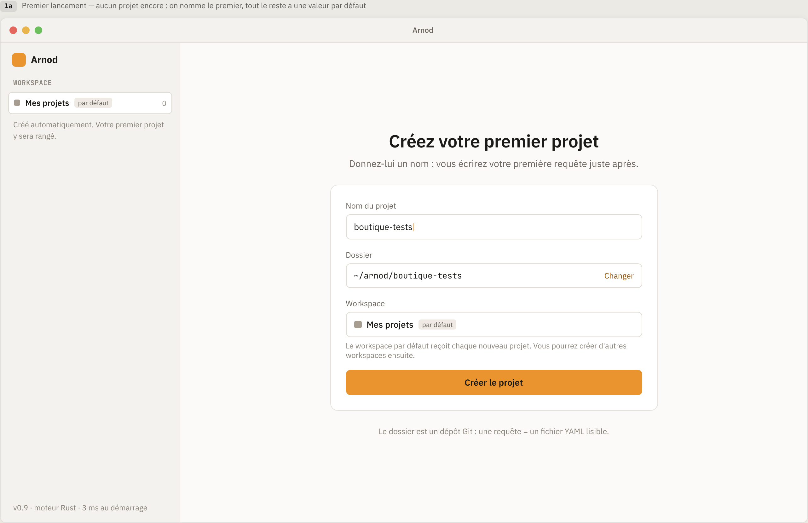
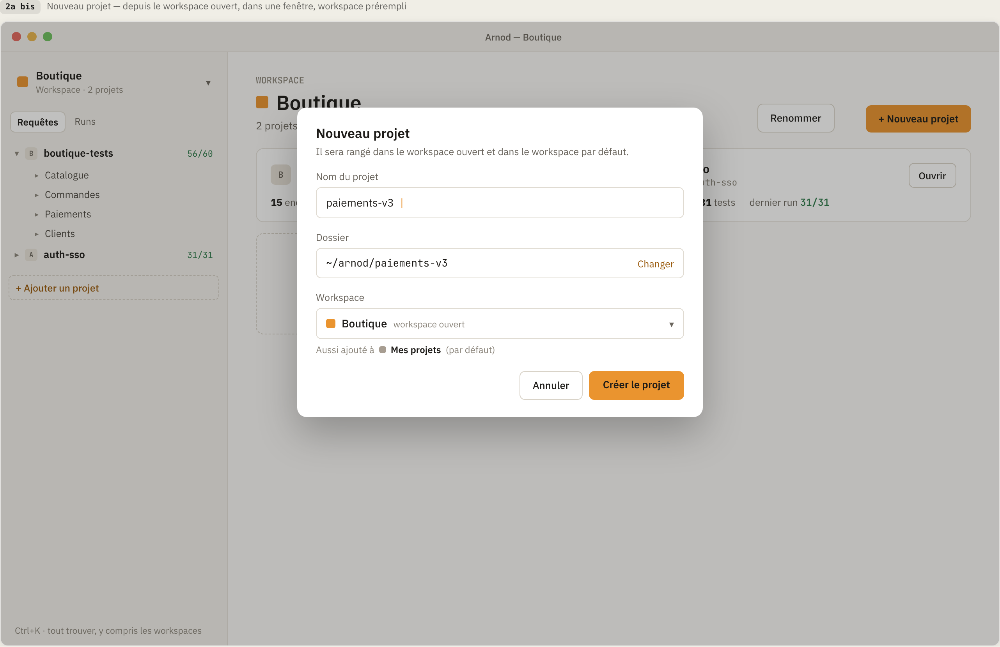
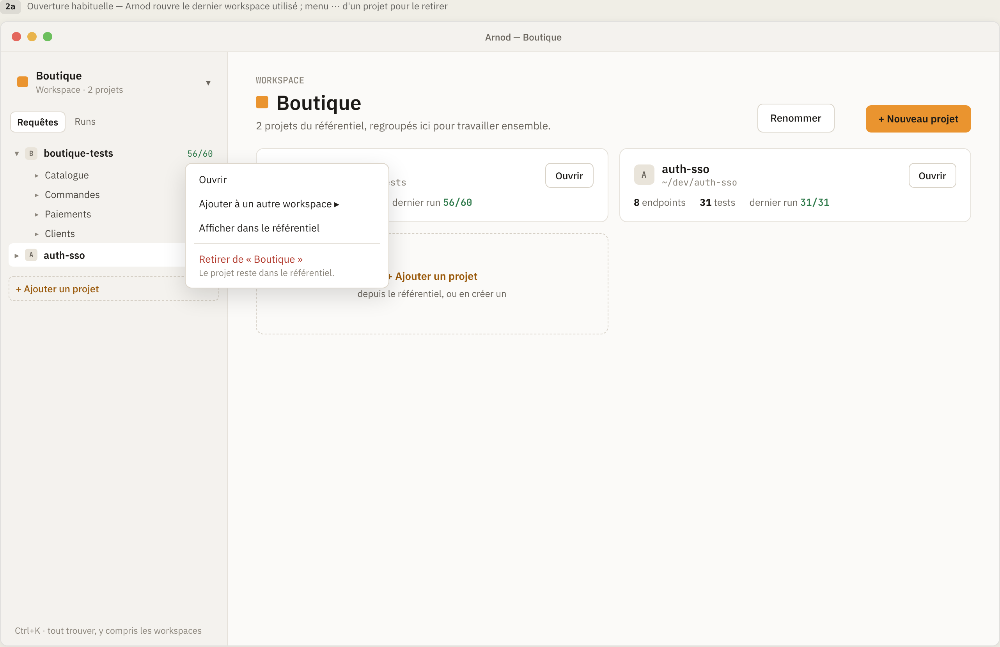
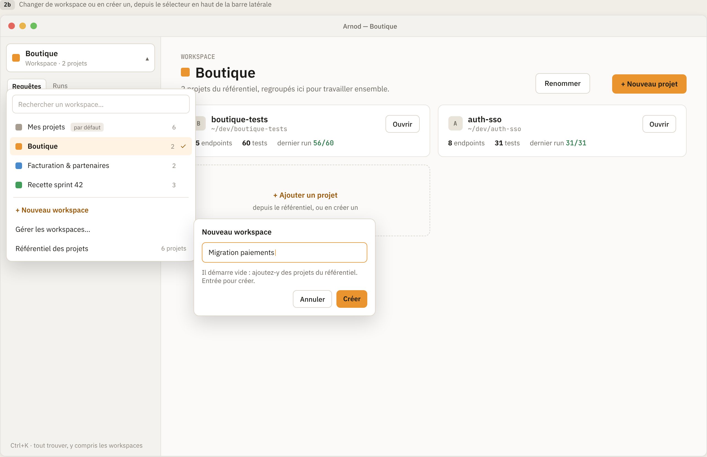
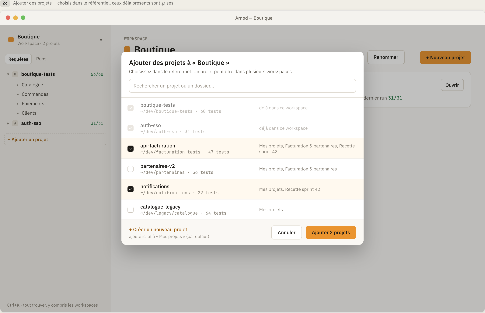
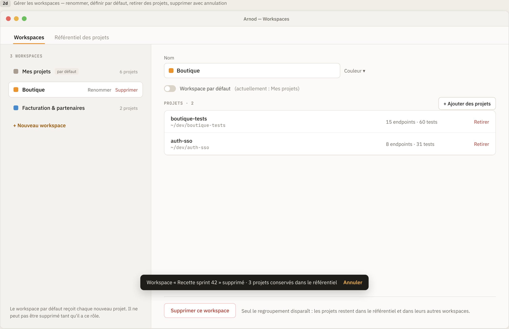
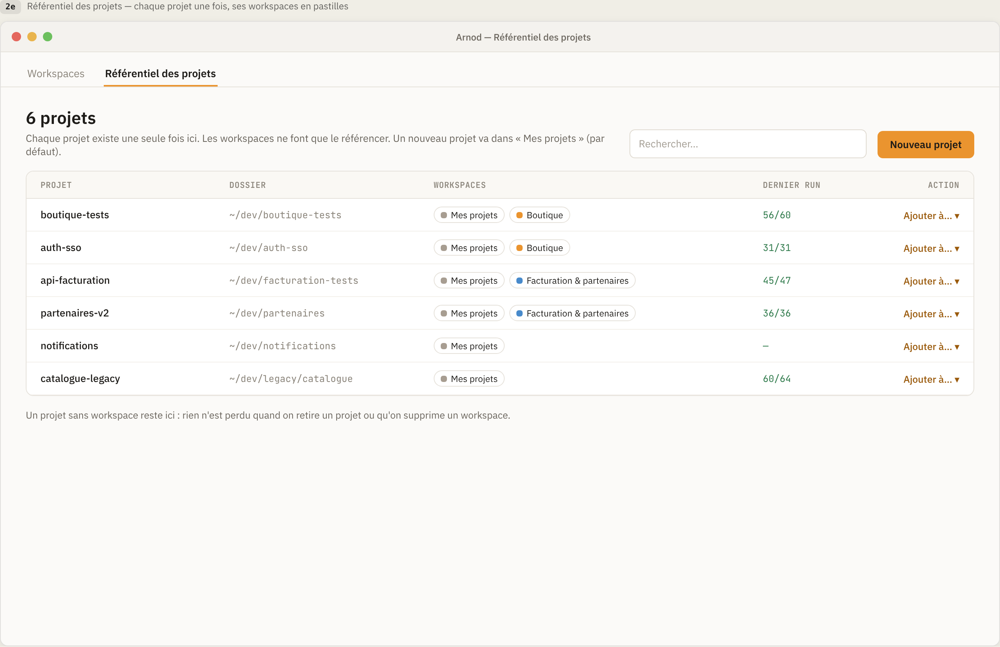

# Plan - Projets et workspaces

**Version** 0.2 · **Date** 2026-11-06 · **Statut** Questions tranchées (§ 11) · **Base** squelette 0.0.1

Plan d'implémentation de deux cas d'usage d'Arnod : **la création et la gestion des projets**,
**la création et la gestion des workspaces**. Il part du squelette décrit dans
[`PRD-squelette.md`](../PRD-squelette.md) et respecte les règles de [`CLAUDE.md`](../CLAUDE.md).

Source : maquette Claude Design « Arnod - Premier usage »
([lien](https://claude.ai/code/artifact/a9ee8986-2c7c-4be7-8600-fb3460033bbe)), sections
« 1. Premier usage (MVP) » et « 2. Workspaces ». Les 12 écrans ont été capturés dans
[`docs/maquettes/`](maquettes/) (1280 × 800, rendu × 2).

## 1. Objectif

À la fin de ce plan, Arnod :

- crée au premier lancement le workspace par défaut « Mes projets » et propose de créer le
  premier projet ;
- crée des projets, c'est-à-dire des dossiers sur disque contenant un manifeste `arnod.yml` ;
- tient un **référentiel** où chaque projet apparaît une seule fois ;
- regroupe des projets du référentiel dans des **workspaces** (un projet peut être dans
  plusieurs workspaces) que l'on crée, renomme, colore, définit par défaut et supprime ;
- rouvre au démarrage le dernier workspace utilisé ;
- conserve tout cela d'une session à l'autre.

Le contenu d'un projet (requêtes, dossiers, assertions, runs) reste hors périmètre : la vue
projet est un emplacement vide, prêt pour le lot « requêtes ».

## 2. Maquettes

| Écran  | Capture                                                                     | Dans ce plan                                                                           |
| ------ | --------------------------------------------------------------------------- | -------------------------------------------------------------------------------------- |
| 1a     | [Premier lancement](maquettes/1a-premier-lancement.png)                     | Oui                                                                                    |
| 1b     | [Projet créé](maquettes/1b-projet-cree.png)                                 | En partie : notification, barre latérale, vue projet vide. L'éditeur de requête : non. |
| 1c     | [Arborescence](maquettes/1c-arborescence.png)                               | Non (requêtes et dossiers)                                                             |
| 1d     | [Nouvelle requête](maquettes/1d-nouvelle-requete.png)                       | Non                                                                                    |
| 1e     | [Requête, assertions, réponse](maquettes/1e-requete-assertions-reponse.png) | Non                                                                                    |
| 1f     | [Run](maquettes/1f-run.png)                                                 | Non                                                                                    |
| 2a     | [Ouverture habituelle](maquettes/2a-ouverture-habituelle.png)               | Oui (sans les statistiques endpoints / tests / dernier run)                            |
| 2a bis | [Nouveau projet](maquettes/2a-bis-nouveau-projet.png)                       | Oui                                                                                    |
| 2b     | [Changer ou créer un workspace](maquettes/2b-changer-creer-workspace.png)   | Oui                                                                                    |
| 2c     | [Ajouter des projets](maquettes/2c-ajouter-projets.png)                     | Oui                                                                                    |
| 2d     | [Gérer les workspaces](maquettes/2d-gerer-workspaces.png)                   | Oui                                                                                    |
| 2e     | [Référentiel des projets](maquettes/2e-referentiel-projets.png)             | Oui (colonne « Dernier run » affichée « — »)                                           |

## 3. Modèle et règles

Repris de la section 2 de la maquette :

- **Référentiel** : liste unique de tous les projets connus d'Arnod.
- **Workspace** : regroupement nommé et coloré d'une sélection de projets du référentiel, pour
  les afficher ensemble.
- **Projet** : un dossier sur disque, prêt à versionner avec Git, où une requête = un fichier YAML
  lisible. Arnod n'initialise pas Git (Q3).

| ID  | Règle                                                                                                                                                                                                                                                            |
| --- | ---------------------------------------------------------------------------------------------------------------------------------------------------------------------------------------------------------------------------------------------------------------- |
| R1  | Un projet n'existe qu'une fois dans le référentiel (unicité par dossier canonique).                                                                                                                                                                              |
| R2  | Un projet appartient à zéro, un ou plusieurs workspaces.                                                                                                                                                                                                         |
| R3  | Il existe toujours exactement un workspace par défaut. Il ne peut pas être supprimé tant qu'il a ce rôle.                                                                                                                                                        |
| R4  | Tout nouveau projet est ajouté au workspace par défaut, et aussi au workspace choisi dans le formulaire s'il est différent.                                                                                                                                      |
| R5  | Retirer un projet d'un workspace ou supprimer un workspace ne supprime jamais le projet ni ses fichiers. Un projet sans workspace reste dans le référentiel.                                                                                                     |
| R6  | Pas de fenêtre de confirmation quand rien n'est perdu : une notification avec « Annuler » suffit.                                                                                                                                                                |
| R7  | Au démarrage, Arnod rouvre le dernier workspace utilisé ; s'il n'existe plus, le workspace par défaut.                                                                                                                                                           |
| R8  | Si le workspace ouvert est supprimé, Arnod bascule sur le workspace par défaut.                                                                                                                                                                                  |
| R9  | Noms : espaces de début et de fin retirés, 1 à 64 caractères. Un nom de workspace est unique parmi les workspaces, un nom de projet est unique dans le référentiel, sans tenir compte de la casse (Q2).                                                          |
| R10 | Le nom d'un projet doit donner un nom de dossier valide sous Windows et Linux (pas de `<` `>` `:` `"` `/` `\` `?` `*` ni de barre verticale, de caractère de contrôle, de point ou d'espace final, ni de nom réservé `CON`, `PRN`, `AUX`, `NUL`, `COM1`…`LPT9`). |
| R11 | Ordre d'affichage : workspace par défaut d'abord, puis les autres par nom ; projets du référentiel par ordre de création.                                                                                                                                        |

## 4. Cas d'usage

Priorités : **Must** (indispensable au lot), **Should** (attendu), **Could** (si le temps le permet).

### 4.1 Projets





| ID  | Cas d'usage                         | Écrans             | Comportement attendu                                                                                                                                                                                                                                                                                                                                                                                                                                                                                                                                                      | Priorité |
| --- | ----------------------------------- | ------------------ | ------------------------------------------------------------------------------------------------------------------------------------------------------------------------------------------------------------------------------------------------------------------------------------------------------------------------------------------------------------------------------------------------------------------------------------------------------------------------------------------------------------------------------------------------------------------------- | -------- |
| P1  | Créer le premier projet             | 1a                 | Sans projet, la zone principale affiche « Créez votre premier projet ». Champs : nom (focus), dossier proposé `~/arnod/<nom>` recalculé tant que l'utilisateur ne l'a pas changé, workspace « Mes projets (par défaut) ». « Créer le projet » crée le dossier et le manifeste, inscrit le projet au référentiel et au workspace par défaut, puis ouvre le projet. Erreur sous le champ si le nom est déjà pris (R9). Mention sous le formulaire adaptée, puisque Arnod n'initialise pas Git (Q3) : « Une requête = un fichier YAML lisible, prêt à versionner avec Git. » | Must     |
| P2  | Créer un projet depuis un workspace | 2a, 2a bis, 2c, 2e | « + Nouveau projet » (2a), « + Créer un nouveau projet » (2c) et « Nouveau projet » (2e) ouvrent une fenêtre modale : même formulaire, workspace prérempli avec le workspace ouvert, mention « Aussi ajouté à Mes projets (par défaut) » quand il diffère (R4). Boutons « Annuler » et « Créer le projet ».                                                                                                                                                                                                                                                               | Must     |
| P3  | Choisir l'emplacement du dossier    | 1a, 2a bis         | « Changer » ouvre le sélecteur de dossier natif. Le dossier choisi est l'emplacement parent : le projet est créé dans `<emplacement>/<nom>` (Q1). Erreurs affichées sous le champ : dossier déjà existant et non vide, projet Arnod déjà présent, droits insuffisants.                                                                                                                                                                                                                                                                                                    | Must     |
| P4  | Notification après création         | 1b                 | « ✓ `<projet>` créé dans le workspace `<workspace>` (par défaut) · Ajouter à un autre… ». L'action ouvre la liste des autres workspaces.                                                                                                                                                                                                                                                                                                                                                                                                                                  | Should   |
| P5  | Ouvrir un projet                    | 2a, 1b             | « Ouvrir » sur une carte ou clic dans la barre latérale. Titre de fenêtre « Arnod — `<projet>` ». Vue projet vide : « Aucune requête pour l'instant ». Le contenu arrive avec le lot requêtes.                                                                                                                                                                                                                                                                                                                                                                            | Must     |
| P6  | Ajouter un projet à un workspace    | 1b, 2a, 2e         | Depuis la notification (P4), le menu ⋯ d'un projet (« Ajouter à un autre workspace ▸ ») ou « Ajouter à… ▾ » du référentiel. Les workspaces qui contiennent déjà le projet sont cochés et inactifs.                                                                                                                                                                                                                                                                                                                                                                        | Must     |
| P7  | Retirer un projet d'un workspace    | 2a, 2d             | Menu ⋯ « Retirer de « `<workspace>` » » (sous-titre « Le projet reste dans le référentiel. ») ou « Retirer » dans 2d. Sans confirmation, notification avec « Annuler » (R5, R6).                                                                                                                                                                                                                                                                                                                                                                                          | Must     |
| P8  | Afficher dans le référentiel        | 2a                 | Menu ⋯ « Afficher dans le référentiel » : ouvre 2e et met la ligne du projet en évidence.                                                                                                                                                                                                                                                                                                                                                                                                                                                                                 | Should   |
| P9  | Consulter le référentiel            | 2e                 | Titre « N projets », texte d'explication, recherche par nom ou dossier, tableau Projet / Dossier / Workspaces (pastilles colorées) / Dernier run (« — » pour l'instant) / Action. Mention « Un projet sans workspace reste ici… ».                                                                                                                                                                                                                                                                                                                                        | Must     |
| P10 | Projet introuvable                  | (hors maquette)    | Si le dossier a été déplacé ou supprimé hors d'Arnod, le projet est marqué « dossier introuvable » (carte, barre latérale, référentiel) et ne s'ouvre pas ; il reste retirable.                                                                                                                                                                                                                                                                                                                                                                                           | Should   |
| P11 | Oublier un projet                   | (hors maquette)    | Retirer le projet du référentiel et de tous ses workspaces sans toucher aux fichiers, avec « Annuler ». À dessiner avant d'être implémenté (Q5).                                                                                                                                                                                                                                                                                                                                                                                                                          | Could    |
| P12 | Ajouter un projet existant          | (hors maquette)    | Choisir un dossier contenant `arnod.yml`, par exemple après un clone Git : le projet est inscrit au référentiel avec l'identifiant de son manifeste et ajouté au workspace par défaut et au workspace ouvert (R4). Refus si le dossier n'a pas de manifeste, si le projet est déjà inscrit ou si son nom est pris (R9). Entrées à dessiner dans 2c et 2e (Q4).                                                                                                                                                                                                            | Should   |

### 4.2 Workspaces











| ID  | Cas d'usage                            | Écrans | Comportement attendu                                                                                                                                                                                                                                                                                                                            | Priorité |
| --- | -------------------------------------- | ------ | ----------------------------------------------------------------------------------------------------------------------------------------------------------------------------------------------------------------------------------------------------------------------------------------------------------------------------------------------- | -------- |
| W1  | Workspace par défaut automatique       | 1a     | Au premier lancement, « Mes projets » (gris) est créé et défini par défaut. La barre latérale l'affiche avec le badge « par défaut », le compteur 0 et « Créé automatiquement. Votre premier projet y sera rangé. »                                                                                                                             | Must     |
| W2  | Rouvrir le dernier workspace           | 2a     | Le workspace ouvert est mémorisé à chaque changement et rouvert au démarrage (R7). Titre de fenêtre « Arnod — `<workspace>` ».                                                                                                                                                                                                                  | Must     |
| W3  | Vue d'un workspace                     | 2a     | En-tête : pastille, nom, « N projets du référentiel, regroupés ici pour travailler ensemble. », « Renommer », « + Nouveau projet ». Cartes projet : initiale, nom, dossier, « Ouvrir », menu ⋯. Carte « + Ajouter un projet depuis le référentiel, ou en créer un ». Barre latérale : sélecteur, projets du workspace, « + Ajouter un projet ». | Must     |
| W4  | Changer de workspace                   | 2b     | Sélecteur en haut de la barre latérale (nom, « Workspace · N projets »). Liste déroulante : recherche, workspaces avec pastille, badge « par défaut », nombre de projets et coche sur le courant ; puis « + Nouveau workspace », « Gérer les workspaces… », « Référentiel des projets (N projets) ». Clavier : flèches, Entrée, Échap.          | Must     |
| W5  | Créer un workspace                     | 2b, 2d | Petite fenêtre « Nouveau workspace » : nom, « Il démarre vide : ajoutez-y des projets du référentiel. Entrée pour créer. », « Annuler » / « Créer ». Couleur attribuée automatiquement (première couleur libre de la palette). Depuis 2b, le workspace créé est ouvert.                                                                         | Must     |
| W6  | Ajouter des projets du référentiel     | 2c, 2d | Fenêtre « Ajouter des projets à « `<workspace>` » » : recherche, liste du référentiel avec cases à cocher, nom, dossier, autres workspaces du projet. Les projets déjà présents sont cochés, grisés, « déjà dans ce workspace ». Bouton « Ajouter N projets » (inactif à 0), lien « + Créer un nouveau projet » (P2).                           | Must     |
| W7  | Renommer un workspace                  | 2a, 2d | « Renommer » (2a) et champ « Nom » (2d). Validation R9 avec message sous le champ.                                                                                                                                                                                                                                                              | Must     |
| W8  | Changer la couleur                     | 2d     | « Couleur ▾ » : palette fixe de 8 couleurs.                                                                                                                                                                                                                                                                                                     | Should   |
| W9  | Définir le workspace par défaut        | 2d     | Interrupteur « Workspace par défaut (actuellement : `<nom>`) ». L'activer sur un autre workspace lui transfère le rôle ; on ne peut pas le désactiver sur le workspace par défaut lui-même (R3).                                                                                                                                                | Must     |
| W10 | Écran « Gérer les workspaces »         | 2d, 2e | Écran à onglets « Workspaces » / « Référentiel des projets ». À gauche « N WORKSPACES » et « + Nouveau workspace » ; à droite le détail : nom, couleur, défaut, « PROJETS · N » avec « Retirer » et « + Ajouter des projets », « Supprimer ce workspace ».                                                                                      | Must     |
| W11 | Supprimer un workspace avec annulation | 2d     | Sans confirmation. Notification « Workspace « X » supprimé · N projets conservés dans le référentiel · Annuler ». Bouton inactif sur le workspace par défaut avec l'explication « Il ne peut pas être supprimé tant qu'il a ce rôle. » (R3, R5, R6, R8).                                                                                        | Must     |

## 5. Hors périmètre

- Contenu des projets : requêtes, dossiers et arborescence (1c, 1d), assertions et réponses (1e),
  runs (1f), et donc les statistiques « endpoints », « tests », « dernier run ».
- Recherche globale `Ctrl+K`.
- Imports (OpenAPI, Bruno, SoapUI, Postman).
- Initialisation Git du dossier : non retenue (Q3). Arnod crée un dossier prêt à versionner,
  l'utilisateur gère Git lui-même.
- Glisser-déposer, réordonnancement manuel des workspaces.
- Plusieurs instances d'Arnod en même temps (une seule instance supposée).

## 6. Architecture

La chaîne reste celle du squelette : composant Vue → store Pinia → `src/lib/ipc.ts` → commande
Rust. Toutes les règles de la section 3 vivent dans le cœur Rust ; le frontend affiche l'état
renvoyé et ne fait que des recherches d'affichage (filtre de liste, nombre d'éléments).

### 6.1 Stockage

**État de l'application** : `arnod.json` dans `app_local_data_dir()`
(`%LOCALAPPDATA%\io.github.juliencorre.arnod\` sous Windows,
`~/.local/share/io.github.juliencorre.arnod/` sous Linux). Dossier local et non itinérant : les
chemins de projets sont propres au poste. Aucun droit administrateur requis.

```json
{
  "version": 1,
  "projects": [
    {
      "id": "0b5c…",
      "name": "boutique-tests",
      "path": "C:\\Users\\julien\\arnod\\boutique-tests",
      "createdAt": "2026-11-06T09:12:00Z"
    }
  ],
  "workspaces": [
    { "id": "9e1a…", "name": "Mes projets", "color": "gray", "projectIds": ["0b5c…"] }
  ],
  "defaultWorkspaceId": "9e1a…",
  "lastWorkspaceId": "9e1a…"
}
```

- Le rôle « par défaut » est porté par `defaultWorkspaceId` et non par un drapeau sur chaque
  workspace : « exactement un défaut » (R3) est garanti par la structure.
- Écriture atomique : fichier temporaire dans le même dossier, puis renommage.
- Fichier absent : premier lancement, création de « Mes projets » (W1).
- Fichier illisible : renommé en `arnod.json.corrompu-<horodatage>`, état neuf, message affiché
  au démarrage. Jamais d'écrasement silencieux.
- `version` supérieure à celle connue (fichier écrit par un Arnod plus récent) : erreur claire et
  aucune écriture.
- Les identifiants sont des UUID v4.

**Le projet sur disque** : `<emplacement>/<nom>/arnod.yml`.

```yaml
# Projet Arnod - https://github.com/juliencorre/Arnod
version: 1
id: 0b5c…
name: boutique-tests
```

Le manifeste porte l'identifiant du projet : il permettra de reconnaître le dossier après un
déplacement ou un clone (P12). Le format des requêtes sera défini par le lot « requêtes ».

### 6.2 Cœur Rust

```
src-tauri/src/
  catalog/              Logique métier pure, sans dépendance à Tauri
    mod.rs              Catalog : référentiel + workspaces, une méthode par règle
    model.rs            Project, Workspace, WorkspaceColor, CatalogFile (format disque)
    names.rs            Validation des noms (R9, R10), dossier proposé
    undo.rs             Pile d'annulation en mémoire (20 entrées, durée de la session)
    error.rs            CatalogError : Serialize, messages en français
  storage.rs            Lecture / écriture d'arnod.json, création du dossier et du manifeste
  state.rs              AppState { catalog: Mutex<Catalog>, undo, chemins }, via app.manage()
  commands/
    hello.rs            Inchangé
    projects.rs         Façades des commandes projets
    workspaces.rs       Façades des commandes workspaces
```

- Chaque mutation suit le même schéma, factorisé dans `AppState::mutate` : copie de l'état,
  application de la règle, écriture sur disque, puis remplacement. Si l'écriture échoue, l'état
  en mémoire reste inchangé.
- Création d'un projet : validation → calcul du dossier → refus si le dossier existe et n'est pas
  vide → création → écriture de `arnod.yml` → inscription au référentiel → sauvegarde. En cas
  d'échec après la création du dossier, le dossier créé par Arnod est supprimé.
- Pas de `unwrap()` : un verrou empoisonné devient une `CatalogError`.
- Le titre de la fenêtre est mis à jour côté Rust (`WebviewWindow::set_title`) à l'ouverture d'un
  workspace ou d'un projet : aucune permission WebView à ajouter.
- Sélecteur de dossier : `tauri-plugin-dialog` appelé **uniquement depuis Rust**
  (`app.dialog().file().blocking_pick_folder()` dans une commande `async`, jamais sur le thread
  principal). Pas de paquet npm `@tauri-apps/plugin-dialog`, pas de permission dans
  `capabilities/default.json` : les permissions ne s'appliquent qu'aux appels venus de la WebView.

Dépendances Rust à ajouter, chacune justifiée par un besoin explicite :

| Crate                  | Usage                                                                                                      |
| ---------------------- | ---------------------------------------------------------------------------------------------------------- |
| `serde_json`           | Passe de `dev-dependencies` à `dependencies` (arnod.json)                                                  |
| `uuid` (`v4`, `serde`) | Identifiants de projets et workspaces                                                                      |
| `serde-saphyr`         | Écriture et lecture de `arnod.yml` (`serde_yaml` est déprécié) ; vérifier l'API à T8, repli `serde_norway` |
| `tauri-plugin-dialog`  | Sélecteur de dossier natif (« Changer »)                                                                   |
| `dunce`                | Chemins canoniques sans préfixe `\\?\` sous Windows (R1)                                                   |
| `tempfile` (dev)       | Tests du stockage dans un dossier temporaire                                                               |

### 6.3 Commandes IPC

Convention : chaque mutation renvoie l'instantané complet du catalogue (`CatalogSnapshot`, quelques
kilo-octets). Le store remplace son état : pas de logique de synchronisation côté Vue. Les
actions annulables renvoient aussi un jeton d'annulation.

| Commande                        | Arguments                          | Réponse                     | Écrans          |
| ------------------------------- | ---------------------------------- | --------------------------- | --------------- |
| `catalog_load`                  | -                                  | `CatalogSnapshot`           | Démarrage       |
| `project_suggest_folder`        | `{ name, location? }`              | `string`                    | 1a, 2a bis      |
| `project_pick_folder`           | -                                  | `string \| null`            | 1a, 2a bis, P12 |
| `project_create`                | `{ name, location?, workspaceId }` | `{ snapshot, projectId }`   | 1a, 2a bis      |
| `project_open`                  | `{ projectId }`                    | `ProjectView`               | 2a, 1b          |
| `workspace_open`                | `{ workspaceId }`                  | `CatalogSnapshot`           | 2a, 2b          |
| `workspace_create`              | `{ name }`                         | `{ snapshot, workspaceId }` | 2b, 2d          |
| `workspace_rename`              | `{ workspaceId, name }`            | `CatalogSnapshot`           | 2a, 2d          |
| `workspace_set_color`           | `{ workspaceId, color }`           | `CatalogSnapshot`           | 2d              |
| `workspace_set_default`         | `{ workspaceId }`                  | `CatalogSnapshot`           | 2d              |
| `workspace_add_projects`        | `{ workspaceId, projectIds }`      | `CatalogSnapshot`           | 1b, 2a, 2c, 2e  |
| `workspace_remove_project`      | `{ workspaceId, projectId }`       | `{ snapshot, undoToken }`   | 2a, 2d          |
| `workspace_delete`              | `{ workspaceId }`                  | `{ snapshot, undoToken }`   | 2d              |
| `undo`                          | `{ undoToken }`                    | `CatalogSnapshot`           | Notifications   |
| `project_add_existing` (Should) | `{ path, workspaceId }`            | `{ snapshot, projectId }`   | P12             |
| `project_forget` (Could)        | `{ projectId }`                    | `{ snapshot, undoToken }`   | 2e              |

Types miroirs dans `src/types/ipc.ts` (sérialisation `camelCase`) :

```ts
type WorkspaceColor = "gray" | "orange" | "blue" | "green" | "purple" | "red" | "yellow" | "teal";

interface ProjectView {
  id: string;
  name: string;
  path: string;
  status: "ok" | "missing"; // P10, calculé à chaque instantané
  workspaceIds: string[]; // pastilles de 2c et 2e
}

interface WorkspaceView {
  id: string;
  name: string;
  color: WorkspaceColor;
  isDefault: boolean;
  projectIds: string[];
}

interface CatalogSnapshot {
  projects: ProjectView[]; // ordre R11
  workspaces: WorkspaceView[]; // ordre R11
  defaultWorkspaceId: string;
  lastWorkspaceId: string;
}

/** Erreur renvoyée par toute commande ; `message` est prêt à afficher. */
interface CommandError {
  kind:
    | "invalidName"
    | "nameTaken"
    | "folderNotEmpty"
    | "alreadyRegistered"
    | "notAProject"
    | "notFound"
    | "defaultWorkspace"
    | "undoExpired"
    | "io"
    | "corruptState"
    | "newerVersion";
  message: string;
}
```

`IpcError` expose `kind` quand la cause est une `CommandError`, et reprend son `message`.

### 6.4 Frontend

Pas de `vue-router` (pas de nouvelle dépendance) : un store de navigation suffit pour quatre vues.

```
src/
  stores/
    catalog.ts          Instantané, une action par commande, erreur courante
    navigation.ts       Vue courante : premier lancement | workspace | projet | gestion (onglet)
    toasts.ts           File de notifications, action facultative (« Annuler », « Ajouter à un autre… »)
  components/
    layout/AppShell.vue, Sidebar.vue
    workspaces/WorkspaceSwitcher.vue (2b), WorkspaceCreatePopover.vue (2b), WorkspaceHome.vue (2a)
    projects/ProjectForm.vue (1a et 2a bis), FirstRun.vue (1a), NewProjectDialog.vue (2a bis),
             ProjectCard.vue, ProjectMenu.vue (⋯ de 2a), AddProjectsDialog.vue (2c), ProjectView.vue (1b)
    manage/ManageScreen.vue (onglets), WorkspacesTab.vue (2d), RegistryTab.vue (2e)
    ui/BaseButton.vue, BaseDialog.vue (<dialog> natif), BaseMenu.vue (menu et sous-menu),
       ToggleSwitch.vue, ColorDot.vue, SearchInput.vue, ToastHost.vue
```

- `App.vue` devient la coquille ; la démonstration « hello » quitte l'interface. La commande
  `hello` et ses tests Rust restent comme exemple de référence.
- Accessibilité : `<dialog>` natif pour les fenêtres modales (focus piégé, Échap), rôles
  `menu` / `menuitem` et navigation au clavier dans les menus, `role="status"` et
  `aria-live="polite"` pour les notifications, Entrée pour valider partout.
- Notifications : une à la fois, 6 s, prolongée au survol et au focus.

### 6.5 Design

- Palette des maquettes traduite en variables dans `src/styles.css`, avec une déclinaison sombre ;
  l'accent orange remplace le bleu du squelette (Q6) :
  `--color-bg` (#fbfaf8), `--color-surface` (#fff), `--color-sidebar` (#f4f2ee),
  `--color-border` (#e6e2db), `--color-text` (#1d1b18), `--color-muted` (#6b665e),
  `--color-subtle` (#8b857b), `--color-accent` (orange ≈ #e8962e), `--color-link` (#9a5a0c),
  `--color-success` (#2f7a4b), `--color-danger`, `--color-toast-bg`, et la palette des workspaces
  `--color-ws-gray`, `--color-ws-orange`, `--color-ws-blue`, `--color-ws-green`… Valeurs en
  hexadécimal (les maquettes utilisent `oklch`, moins sûr sous WebKitGTK d'Ubuntu 22.04).
- Polices : police système (N7). Les polices Google des maquettes sont interdites par la CSP ;
  chasse fixe : `ui-monospace, "Cascadia Mono", Consolas, "DejaVu Sans Mono", monospace`.
- Fenêtre : 1280 × 800 par défaut, minimum 960 × 600 ; barre latérale de 260 px.

## 7. Impacts sur l'existant

| Fichier                               | Changement                                                                                                                                                                                               |
| ------------------------------------- | -------------------------------------------------------------------------------------------------------------------------------------------------------------------------------------------------------- |
| `CLAUDE.md`                           | La persistance sort de la liste « hors périmètre ». Ajout : module `catalog`, stockage local atomique, `CommandError`, convention « mutation → instantané », dialog côté Rust. Arborescence mise à jour. |
| `src-tauri/tauri.conf.json`           | Taille de fenêtre. CSP inchangée.                                                                                                                                                                        |
| `src-tauri/capabilities/default.json` | Inchangé (à vérifier : aucun appel de plugin depuis la WebView).                                                                                                                                         |
| `src-tauri/Cargo.toml`                | Dépendances du § 6.2.                                                                                                                                                                                    |
| `scripts/smoke-windows.ps1`           | Attend « Hello World » : attendre « Créez votre premier projet » (poste CI vierge = premier lancement).                                                                                                  |
| `scripts/smoke-linux.sh`              | Cherche le titre exact `^Arnod$` : accepter `^Arnod( — .+)?$`.                                                                                                                                           |
| `tests/App.spec.ts`                   | Réécrit pour la coquille (premier lancement, workspace rouvert).                                                                                                                                         |
| `README.md`                           | Tableau des fonctions et captures.                                                                                                                                                                       |
| Installeur                            | Mesurer après l'ajout du plugin et des crates (N3 : < 15 Mo, vérifié par `scripts/bundle-size.mjs`).                                                                                                     |

## 8. Plan de tâches pour Claude Code

Un lot = une pull request. Lint, format, typecheck, tests Vitest, `cargo fmt`, `clippy` et
`cargo test` passent avant chaque commit ; chaque tâche est relue avant commit.

**Lot A - Fondations**

- [x] **T1** Mettre à jour `CLAUDE.md` (§ 7) et y reporter les décisions du § 11.
- [x] **T2** Palette et variables CSS clair / sombre (§ 6.5), taille de fenêtre.
- [x] **T3** Type `CommandError { kind, message }` côté Rust et TypeScript, `IpcError.kind`, tests.

**Lot B - Cœur Rust (sans interface)**

- [ ] **T4** `catalog/model.rs` et `catalog/names.rs` : types, validation R9 et R10, dossier proposé.
- [ ] **T5** `catalog/mod.rs` : une méthode par règle (création, renommage, couleur, défaut,
      suppression de workspace ; inscription, ajout et retrait de projets) ; un test par règle R1 à R11.
- [ ] **T6** `catalog/undo.rs` : annulation du retrait d'un projet et de la suppression d'un workspace.
- [ ] **T7** `storage.rs` : lecture, écriture atomique, premier lancement (W1), fichier corrompu,
      version plus récente ; tests dans un dossier temporaire.
- [ ] **T8** Création du projet sur disque : dossier, `arnod.yml`, nettoyage en cas d'échec,
      « dossier non vide », « projet déjà inscrit ».
- [ ] **T9** `state.rs`, `commands/projects.rs`, `commands/workspaces.rs`, enregistrement dans
      `generate_handler!` ; tests de la forme JSON de `CatalogSnapshot` et des erreurs.
- [ ] **T10** Sélecteur de dossier `project_pick_folder` (`tauri-plugin-dialog` côté Rust) et titre de fenêtre ;
      mesure de la taille de l'installeur.

**Lot C - Frontend : socle**

- [ ] **T11** `src/types/ipc.ts`, `src/lib/ipc.ts`, tests `mockIPC` de chaque commande.
- [ ] **T12** Stores `catalog`, `navigation`, `toasts` et leurs tests.
- [ ] **T13** Composants `ui/` (bouton, dialogue, menu et sous-menu, interrupteur, pastille,
      recherche, notification) avec tests clavier.
- [ ] **T14** Coquille : barre latérale et zone principale ; au démarrage, premier lancement ou
      dernier workspace (W2).

**Lot D - Projets**

- [ ] **T15** Premier lancement (1a) : P1, P3, W1.
- [ ] **T16** Vue projet vide (1b) et notification « créé dans… · Ajouter à un autre… » : P4, P5.
- [ ] **T17** Nouveau projet en fenêtre modale (2a bis) : P2.

**Lot E - Workspaces au quotidien**

- [ ] **T18** Vue workspace (2a) : W3, W7 (bouton « Renommer »).
- [ ] **T19** Menu ⋯ d'un projet : P5, P6, P7 avec « Annuler », P8.
- [ ] **T20** Sélecteur de workspace avec recherche et création (2b) : W4, W5.
- [ ] **T21** Ajouter des projets (2c) : W6.

**Lot F - Gestion**

- [ ] **T22** « Gérer les workspaces » (2d) : W7 à W11.
- [ ] **T23** Référentiel (2e) : P9, P6 (« Ajouter à… »), P2, mise en évidence de P8.
- [ ] **T24** Projet introuvable : P10. P11 une fois dessiné (Q5).

**Lot G - Finitions et CI**

- [ ] **T25** Tests de fumée Windows et Linux adaptés (§ 7) ; captures CI relues.
- [ ] **T26** Thème sombre et accessibilité vérifiés, README (captures, tableau des fonctions).

**Lot H - Après le plan principal**

- [ ] **T27** Dessiner puis implémenter l'ajout d'un projet existant (P12) : commande
      `project_add_existing`, lecture de `arnod.yml`, entrées dans 2c et 2e.

## 9. Critères d'acceptation

- [ ] Premier lancement sur un poste vierge : « Mes projets » existe, est par défaut, et la page
      « Créez votre premier projet » s'affiche.
- [ ] Créer `boutique-tests` crée `~/arnod/boutique-tests/arnod.yml`, ajoute le projet au
      référentiel et à « Mes projets », l'ouvre et affiche la notification.
- [ ] Un projet créé depuis le workspace « Boutique » est dans « Boutique » et dans « Mes projets ».
- [ ] Un nom de projet ou de workspace déjà pris est refusé, quelle que soit la casse.
- [ ] Un projet peut être dans plusieurs workspaces ; le référentiel l'affiche une seule fois avec
      toutes ses pastilles.
- [ ] Retirer un projet d'un workspace ou supprimer un workspace ne touche ni au référentiel ni
      aux fichiers ; « Annuler » rétablit l'état précédent.
- [ ] Le workspace par défaut ne peut pas être supprimé ; on peut transférer ce rôle.
- [ ] Après fermeture et relance, Arnod rouvre le dernier workspace utilisé, avec les mêmes
      projets, noms et couleurs.
- [ ] Un dossier de projet supprimé hors d'Arnod est signalé sans planter l'application.
- [ ] Sous Windows, compte standard : aucune invite UAC, état stocké dans `%LOCALAPPDATA%`.
- [ ] Installeur Windows < 15 Mo ; CI verte sous Windows et Linux.
- [ ] Toutes les actions sont faisables au clavier ; thèmes clair et sombre lisibles.

## 10. Risques

| Risque                                                      | Impact                         | Parade                                                                                 |
| ----------------------------------------------------------- | ------------------------------ | -------------------------------------------------------------------------------------- |
| Chemins Windows (casse, `\\?\`, noms réservés)              | Doublons, dossiers impossibles | `dunce`, validation R10, tests dédiés.                                                 |
| `arnod.json` corrompu ou écrit par une version plus récente | Perte du référentiel           | Sauvegarde du fichier, message, aucune écriture (§ 6.1).                               |
| Deux instances d'Arnod écrivent le même fichier             | Modifications perdues          | Hors périmètre ; `tauri-plugin-single-instance` plus tard (nouveau plugin = décision). |
| Taille de l'installeur                                      | N3 dépassé                     | Mesure à T10, crates légères.                                                          |
| Crate YAML                                                  | Maintenance                    | `serde-saphyr` actif ; repli `serde_norway` ; le manifeste reste minimal.              |
| Annulation perdue à la fermeture                            | Faible                         | Accepté : la notification disparaît de toute façon.                                    |

## 11. Décisions

Questions tranchées le 2026-11-06.

| ID  | Question                                                                                    | Décision                                                                                      |
| --- | ------------------------------------------------------------------------------------------- | --------------------------------------------------------------------------------------------- |
| Q1  | « Changer » choisit-il l'emplacement parent ou le dossier exact du projet ?                 | Emplacement parent : le projet est créé dans `<emplacement>/<nom>`, comme dans Bruno (P3).    |
| Q2  | Les noms de projet sont-ils uniques dans le référentiel ?                                   | Oui, sans tenir compte de la casse (R9).                                                      |
| Q3  | La maquette 1a annonce « Le dossier est un dépôt Git ». Initialise-t-on Git à la création ? | Non. Arnod crée un dossier prêt à versionner ; la mention de la maquette 1a est adaptée (P1). |
| Q4  | Peut-on ajouter au référentiel un dossier projet existant (après un clone Git) ?            | Oui, en Should, dans le lot H après le plan principal (P12, T27). Interface à dessiner.       |
| Q5  | Peut-on oublier un projet (le retirer du référentiel) ?                                     | Could ; à dessiner avant de l'implémenter (P11).                                              |
| Q6  | Adopte-t-on l'accent orange des maquettes à la place du bleu du squelette ?                 | Oui, avec une déclinaison sombre (§ 6.5).                                                     |
